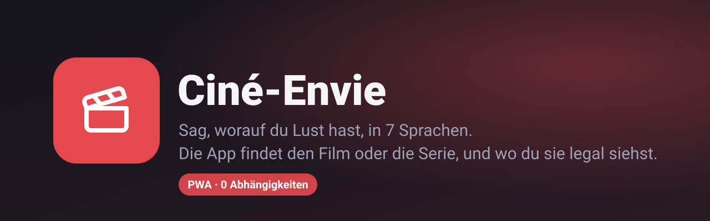
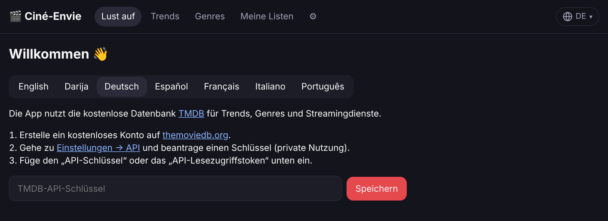
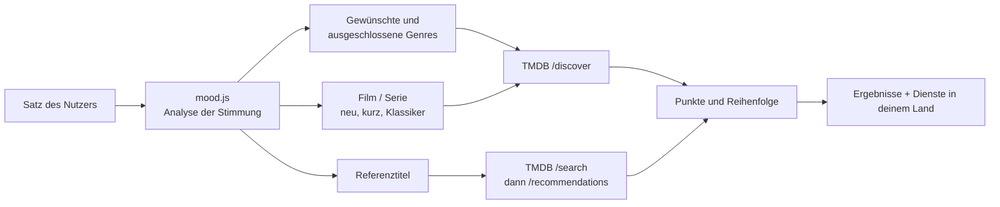

<p align="center"><a href="README.md">English</a> · <a href="README.drj.md">Darija</a> · <b>Deutsch</b> · <a href="README.es.md">Español</a> · <a href="README.fr.md">Français</a> · <a href="README.it.md">Italiano</a> · <a href="README.pt.md">Português</a></p>

<p align="center">
  
</p>

<p align="center">
  <a href="https://rliu-labs.github.io/cine-envie/"><b>▶ App ausprobieren</b></a>
  ·
  <a href="#funktionen">Funktionen</a>
  ·
  <a href="#so-funktionierts">So funktioniert's</a>
  ·
  <a href="#sicherheit-und-datenschutz">Sicherheit</a>
  ·
  <a href="#lokal-starten">Lokal starten</a>
</p>

<p align="center">
  <a href="https://rliu-labs.github.io/cine-envie/"></a>
  <a href="https://github.com/rliu-labs/cine-envie/actions/workflows/tests.yml"></a>
  
  
  
  <a href="LICENSE"></a>
</p>

---

**Ciné‑Envie** beantwortet die Frage, die sich jeden Abend stellt: *„Was schauen wir?“*.
Du beschreibst, worauf du Lust hast, so wie du es einem Freund sagen würdest, **auf Deutsch, Englisch, Französisch, Spanisch, Italienisch, Portugiesisch oder marokkanischem Darija**, und die App schlägt passende Filme und Serien vor, mit **den legalen Streamingangeboten in deinem Land** (31 europäische Länder).

> „Ein gemütlicher, lustiger Abend mit Krimi, wie Knives Out“
> → Stimmung *gemütlich, lustig, Rätsel* · kein Horror, kein Thriller · ähnlich wie *Knives Out*

Es ist eine installierbare Web-App (PWA) ohne Server, ohne Konto und ohne Abhängigkeiten: HTML, CSS und natives JavaScript.

<p align="center">
  
</p>

## Funktionen

| | |
|---|---|
| 💬 **Lust auf** | Suche in natürlicher Sprache, auch umgangssprachlich: Stimmung, Genres, die du nicht willst, Film oder Serie, neu / kurz / Klassiker und ein Referenztitel („wie Dark“, „like Dark“, „comme Dark“, „come Dark“). |
| 🌍 **7 Sprachen** | Oberfläche und Suche auf **Englisch**, **Darija** (marokkanisch, in lateinischer Schrift mit den Ziffern 3, 7, 9…), **Deutsch**, **Spanisch**, **Französisch**, **Italienisch** und **Portugiesisch**. Die App startet auf Englisch; die Sprache wechselst du mit einem Klick im Menü oben (Globus) oder in den Einstellungen. |
| 📺 **Filme und Serien** | Suche, Genres, Trends, Bewertungen und Empfehlungen umfassen Filme und Serien. Auf der Suchseite wählst du mit einem Klick **Filme**, **Serien** oder **Beides**. |
| 🍿 **Meine Streamingdienste** | Hake in den Einstellungen deine Abos an (standardmäßig Netflix, Prime Video und Disney+; je nach Land auch WOW, RTL+…). Sie werden zu Buttons auf der Suchseite: „Alle“ sucht bei allen deinen Diensten, ein Klick auf einen Dienst grenzt die Suche ein. Deine Dienste werden auch auf jeder Titelseite hervorgehoben. |
| 📍 **Dein Land** | Wähle dein Wohnland aus 31 europäischen Ländern, direkt auf der Titelseite: Angezeigt werden die Dienste, die es bei dir gibt. |
| 🔥 **Trends** | Die Filme und Serien der Woche, mit einem **Neu**-Abzeichen für alles, was seit deinem letzten Besuch dazugekommen ist. |
| 🎭 **Genres** | Stöbern nach Genre, Beliebtheit oder Bewertung. |
| 🎬 **Titelseite** | Inhalt, Regie, Besetzung mit Fotos, Trailer direkt auf der Seite und die legalen Angebote im gewählten Land (Abo, kostenlos, leihen, kaufen). Tippe auf eine Person, um ihre anderen Filme und Serien zu sehen. |
| ⭐ **Geschmacksprofil** | Bewerte Gesehenes mit 1 bis 5 Sternen: Die App erkennt, welche Genres du magst oder meidest, passt die Reihenfolge jeder Suche an und schlägt eine Auswahl „Für dich empfohlen“ vor. |
| 📋 **Meine Listen** | „Merkliste“ und „Gesehen“, im Browser gespeichert, mit JSON-Export / -Import für den Gerätewechsel. |
| 📱 **Installierbar** | Auf dem Computer (Chrome, Edge), Android und iPhone; die Oberfläche funktioniert auch offline. |
| 🖥️ **TV-Modus** | Auf einem Smart-TV oder einer TV-Box (Android TV, Google TV, Fire TV, Samsung, LG…) wechselt die App von selbst in eine große Ansicht, die vom Sofa aus lesbar ist, und wird mit der Fernbedienung gesteuert: Pfeile zum Bewegen, OK zum Öffnen, Zurück zum Schließen. Erzwingen lässt er sich in den Einstellungen (Anzeige: Auto, Handy / Computer, TV) oder mit `?tv=1` in der Adresse. |
| 🔎 **Titelsuche und Sprache** | Suche nach Stimmung oder Titel, mit Vorschlägen beim Tippen, einem 🎤-Knopf zum Diktieren und **Mehr anzeigen** unter jeder Liste. |
| 📲 **Vom Handy auf den Fernseher mit einem Scan** | Scanne mit dem Handy den QR-Code auf dem Fernseher: Er erhält Schlüssel, Einstellungen und Listen. |
| 🌗 **Helles oder dunkles Design** | Auto, hell oder dunkel. |

## Läuft auf jedem Bildschirm

Dieselbe App passt sich dem Gerät an, ohne Einstellungen:

| Gerät | Ansicht und Bedienung | Getestete Browser |
|---|---|---|
| 📱 **Handy** | Eine Spalte, große Touch-Flächen, auf dem Startbildschirm installierbar. | Safari (iPhone), Chrome (Android) |
| 💻 **Computer** | Breites Poster-Raster, Maus oder Tastatur (Tab, Enter, Esc). | Chrome, Edge, Firefox, Safari |
| 🖥️ **TV** | Große Ansicht, vom Sofa aus lesbar, Ränder gegen Bildbeschnitt, Fernbedienung: Pfeile, OK, Zurück. Schaltet sich auf Smart-TVs und TV-Boxen von selbst ein. | Samsung (Tizen), LG (webOS), Android TV / Google TV, Fire TV |

Tablets erhalten je nach Breite die Handy- oder Computer-Ansicht. Selbst wählen: **Einstellungen → Anzeige** (Auto, Handy / Computer, TV) oder `?tv=1` (bzw. `?tv=0`) in der Adresse.

## Läuft auf jedem Bildschirm

Dieselbe App passt sich dem Gerät an, ohne Einstellungen:

| Gerät | Ansicht und Bedienung | Getestete Browser |
|---|---|---|
| 📱 **Handy** | Eine Spalte, große Touch-Flächen, auf dem Startbildschirm installierbar. | Safari (iPhone), Chrome (Android) |
| 💻 **Computer** | Breites Poster-Raster, Maus oder Tastatur (Tab, Enter, Esc). | Chrome, Edge, Firefox, Safari |
| 🖥️ **TV** | Große Ansicht, vom Sofa aus lesbar, Ränder gegen Bildbeschnitt, Fernbedienung: Pfeile, OK, Zurück. Schaltet sich auf Smart-TVs und TV-Boxen von selbst ein. | Samsung (Tizen), LG (webOS), Android TV / Google TV, Fire TV |

Tablets erhalten je nach Breite die Handy- oder Computer-Ansicht. Selbst wählen: **Einstellungen → Anzeige** (Auto, Handy / Computer, TV) oder `?tv=1` (bzw. `?tv=0`) in der Adresse.

## So funktioniert's

Das Herz der App ist [`js/mood.js`](js/mood.js): ein kleiner Parser für natürliche Sprache (Englisch, Deutsch, Französisch, Spanisch, Italienisch, Portugiesisch, Darija), ohne externen Dienst, der einen Satz in Suchkriterien übersetzt.



Echte Ausgaben des Parsers:

| Was du schreibst | Stimmung | Typ | Ausgeschlossen | Referenz |
|---|---|---|---|---|
| Ein gemütlicher, lustiger Abend mit Krimi, wie Knives Out | gemütlich, lustig, Rätsel | alles | Horror, Thriller, Kriegsfilm | Knives Out |
| ein neuer Actionfilm, der sich nicht zu ernst nimmt | Action | Film · neu | | |
| eine spannende Serie wie Dark | Spannung | Serie | | Dark |
| ein Klassiker aus den 80ern zum Heulen | emotional | alles · Klassiker | | |
| A cozy, funny night with some mystery, like Knives Out | gemütlich, lustig, Rätsel | alles | Horror, Thriller, Kriegsfilm | Knives Out |
| una serie de suspense como Dark | Rätsel, Spannung | Serie | | Dark |
| bghit chi film dyal d7k | lustig | Film | | |

Jedes Ergebnis bekommt dann Punkte: +3 pro gewünschtem Genre, −6 pro ausgeschlossenem Genre, dazu Bewertung und Beliebtheit, und einen Bonus, wenn es aus den Empfehlungen zum Referenztitel stammt.

Auf **Deutsch** versteht der Parser auch Umgangssprache („gruselig“, „zum Heulen“, „Schnulze“, „Ballerei“…) und zusammengesetzte Wörter wie „Actionfilm“ oder „Liebesfilm“; die TMDB-Titelseiten erscheinen dann auf Deutsch. Italienisch, Portugiesisch und Spanisch funktionieren genauso.

**Darija** hat in lateinischer Schrift keine feste Rechtschreibung: Der Parser vereinheitlicht zuerst die Ziffern-Buchstaben (3 → ع, 7 → ح, 9 → ق…) und Doppelbuchstaben und erkennt die Wörter dann mit flexiblen Mustern, die Schreibvarianten („d7k“, „dahk“, „kaydahek“) und Verbpräfixe zulassen. Die Darija-Oberfläche folgt der in Marokko üblichen „Arabizi“-Schreibweise; sie sollte noch von Muttersprachlern geprüft werden, Vorschläge sind willkommen. TMDB-Titelseiten erscheinen dann auf Französisch.

Das **Geschmacksprofil** fließt in diese Punkte ein: Jede Bewertung gibt ihren Genres eine Affinität zwischen −1 (1★) und +1 (5★), gemittelt und geglättet, damit ein einzelner Film nicht alles bestimmt. Alles wird im Browser berechnet.

## Architektur

```
├── index.html             Grundgerüst der App
├── style.css              Dunkles Design, responsives Layout
├── js/
│   ├── app.js             Ansichten, Hash-Navigation, Titelseite
│   ├── mood.js            Analyse der Stimmung und Punktevergabe (reines JS, getestet)
│   ├── i18n.js            Texte in 7 Sprachen, europäische Länder, Erkennung des Landes
│   ├── tmdb.js            TMDB-API-Client (Sprache und Land einstellbar, Cache im Speicher)
│   └── store.js           Lokaler Speicher: Sprache, Land, Schlüssel, Listen, Bewertungen, letzter Besuch
├── sw.js                  Service Worker (Offline-Oberfläche, Cache für Poster)
├── manifest.webmanifest   PWA-Manifest
├── icons/                 App-Icon, TMDB-Logo
├── scripts/captures.mjs   Erzeugt Screenshots und GIF für das README (Playwright)
└── tests/                 Tests mit node:test (Parser, Profil, Übersetzungen, TMDB-Client)
```

**Technische Entscheidungen**
- **Kein Build, keine Abhängigkeiten**: native ES-Module, von GitHub Pages direkt ausgeliefert.
- **v3-Schlüssel oder v4-Token**: Der Client erkennt das Format und nutzt den Parameter `api_key` oder den Header `Bearer`.
- **Service Worker „Netzwerk zuerst“**: Updates kommen sofort an, offline übernimmt der Cache.

## Sicherheit und Datenschutz

Ciné‑Envie ist so gebaut, dass es nichts über dich weiß.

| | |
|---|---|
| 🖥️ **Kein Server** | 100 % statische Website auf GitHub Pages, über HTTPS ausgeliefert. |
| 🔑 **Dein Schlüssel bleibt bei dir** | Der TMDB-Schlüssel wird in deinem Browser gespeichert und nur an die TMDB-API gesendet. |
| 🙈 **Kein Tracking** | Keine Statistiken, keine Werbung, keine Cookies. |
| 🌐 **Was dein Browser kontaktiert** | TMDB (Daten und Bilder) und GitHub Pages, das die App hostet und deine IP-Adresse protokollieren kann. Trailer öffnen sich auf YouTube. |
| 📲 **Übertragung und Sprache** | Die Übertragung Handy → Fernseher ist verschlüsselt und läuft über ein öffentliches Relais, das sie nicht lesen kann; die Sprachsuche nutzt den Sprachdienst des Browsers. Details im Datenschutzhinweis der App (Fußzeile). |
| 📦 **Keine Abhängigkeiten** | Die Seite lädt kein npm-Paket und kein externes Skript: nichts, was über Dritte kompromittiert werden könnte. (Die einzigen npm-Pakete dienen den Screenshots, nie der App.) |
| 🛡️ **Content Security Policy** | Der Browser blockiert fremde Skripte und jede Verbindung außerhalb von TMDB und dem Relais ntfy.sh. |
| 🧹 **Maskierte Daten** | Alles, was von TMDB oder aus einem Import kommt, wird vor der Anzeige unschädlich gemacht. |

Eine Sicherheitslücke gefunden? In [SECURITY.md](SECURITY.md) steht, wie du sie vertraulich meldest.

## Lokal starten

```bash
git clone https://github.com/rliu-labs/cine-envie.git
cd cine-envie
python3 -m http.server 8000   # oder: npm start
```

Öffne http://localhost:8000 und füge deinen TMDB-Schlüssel ein (kostenlos: themoviedb.org → Einstellungen → API).

Tests:

```bash
npm test
```

Screenshots und Demo-GIF mit echten Daten (dein TMDB-Schlüssel ist nötig):

```bash
npm install
npx playwright install chromium
TMDB_KEY=dein_schluessel npm run captures   # Ergebnis in docs/captures/
```

Ideen sind willkommen: siehe [CONTRIBUTING.md](CONTRIBUTING.md).

## Danksagung

<a href="https://www.themoviedb.org/"></a>

Daten und Bilder zu Filmen und Serien: [TMDB](https://www.themoviedb.org/).
*This product uses the TMDB API but is not endorsed or certified by TMDB.*

Streaming-Verfügbarkeit: [JustWatch](https://www.justwatch.com/), über die TMDB-API.

Icon: Piktogramm „clapperboard“ von [Lucide](https://lucide.dev) (ISC-Lizenz, siehe [icons/LICENSE-lucide.txt](icons/LICENSE-lucide.txt)).

Netflix, Prime Video, Disney+ und andere Namen und Logos von Diensten sind Marken ihrer jeweiligen Inhaber. Ciné‑Envie ist mit keinem dieser Dienste verbunden, auch nicht mit TMDB oder JustWatch.

Impressum: kostenloses, nicht kommerzielles Privatprojekt, veröffentlicht von rliu-labs, gehostet von GitHub, Inc. (88 Colin P. Kelly Jr. Street, San Francisco, CA 94107, USA). Kontakt: [GitHub-Issues](https://github.com/rliu-labs/cine-envie/issues).

Code unter [MIT](LICENSE)-Lizenz.
