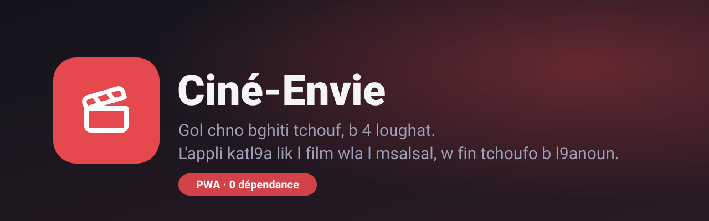
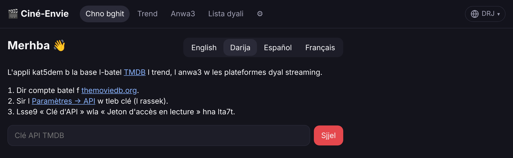
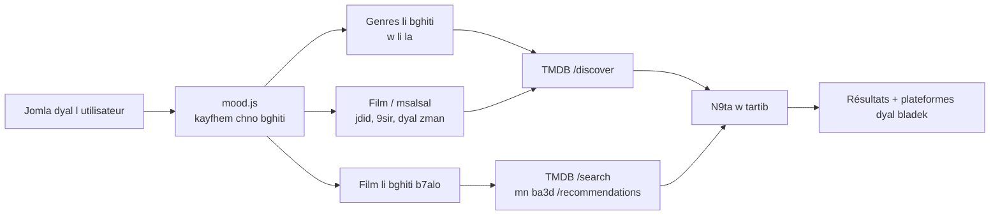

<p align="center"><a href="README.md">English</a> · <b>Darija</b> · <a href="README.de.md">Deutsch</a> · <a href="README.es.md">Español</a> · <a href="README.fr.md">Français</a> · <a href="README.it.md">Italiano</a> · <a href="README.pt.md">Português</a></p>

<p align="center">
  
</p>

<p align="center">
  <a href="https://rliu-labs.github.io/cine-envie/"><b>▶ Jereb l'appli</b></a>
  ·
  <a href="#chno-kaydir">Chno kaydir</a>
  ·
  <a href="#kifach-khdam">Kifach khdam</a>
  ·
  <a href="#aman-w-khousousiya">Aman</a>
  ·
  <a href="#khdem-biha-f-local">Khdem biha f local</a>
</p>

<p align="center">
  <a href="https://rliu-labs.github.io/cine-envie/"></a>
  <a href="https://github.com/rliu-labs/cine-envie/actions/workflows/tests.yml"></a>
  
  
  
  <a href="LICENSE"></a>
</p>

---

**Ciné‑Envie** kayjaweb 3la so2al dyal kol lila : *« chno nchoufo ? »*.
Katkteb chno bghiti b7al ila katgoulha l sa7bek, **b darija, fransawiya, engliziya, sbanyoliya, almaniya, taliyaniya wla portugaliya**, w l'appli kat9tare7 3lik aflam w msalsalat li kayjiw m3a dou9ek, w **fin tchoufhom b l9anoun f bladek** (31 blad f Oroppa).

> « bghit chi film dyal d7k w fih lghaz »
> → mood *d7k, lghaz* · film

Hiya application web katinstalla (PWA), bla serveur, bla compte, bla dépendances : ghir HTML, CSS w JavaScript natif.

<p align="center">
  
</p>

## Chno kaydir

| | |
|---|---|
| 💬 **Chno bghit** | Bi7t b lougha 3adiya, kayfhem 7tta l hadra dyal zn9a : l mood, les genres li ma bghitihomch, film wla msalsal, jdid / 9sir / dyal zman, w film li bghiti b7alo (« b7al Dark », « like Dark », « comme Dark », « como Dark »). |
| 🌍 **7 loughat** | L'interface w l bi7t b **engliziya**, **darija**, **almaniya**, **sbanyoliya**, **fransawiya**, **taliyaniya** w **portugaliya**. Darija kattketeb b l7rouf latiniya m3a l ar9am 3, 7, 9… L'appli kat7ell b l engliziya, w katbeddel lougha b click wa7ed mn l menu li f lfou9 (globe) wla mn Réglages. |
| 📺 **Aflam w msalsalat** | L bi7t, les genres, trend, n9at w recommandations kaychmlo aflam w msalsalat. F page dyal l bi7t, b click katkhtar **Aflam**, **Msalsalat** wla **Bjouj**. |
| 🍿 **Les plateformes dyali** | F Réglages, 3lem 3la les abonnements dyalek (par défaut Netflix, Prime Video w Disney+ ; Canal+, Max… 3la 7sab bladek). Kayweliw boutons f page dyal l bi7t : « Kolhom » kay9elleb f ga3 les plateformes dyalek, w click 3la wa7da kaydi9 l bi7t. Les plateformes dyalek kaybano 7tta f kol fiche. |
| 📍 **Bladek** | Khtar l blad li sakn fiha mn 31 blad f Oroppa, direct mn l fiche : les plateformes li kaybano homa li kaynin 3endek. |
| 🔥 **Trend** | Aflam w msalsalat li machi l7al had simana, m3a badge **Jdid** 3la dakchi li ban mn a5er merra jiti. |
| 🎭 **Anwa3** | T9elleb b genre, b chno machi l7al wla b a7san n9at. |
| 🎬 **Fiche** | Résumé, réalisateur, casting, bande‑annonce w les offres l9anouniya f l blad li khtarti (abonnement, batel, kra, chra). |
| ⭐ **Dou9ek** | 3ti n9ta mn 1 l 5 njoum l dakchi li cheftih : l'appli kat3ref chno kat7ebb w chno la, katrteb l bi7t 3la 7sab dou9ek w kat9tare7 3lik « Mkhtarin lik ». |
| 📋 **Les listes dyali** | « Nchoufo » w « Chefthom », m7foudin f navigateur, m3a export / import JSON bach tbeddel l appareil. |
| 📱 **Katinstalla** | F l ordinateur (Chrome, Edge), Android w iPhone ; l'interface katb9a khdama 7tta bla internet. |
| 🖥️ **Mode TV** | F télé connectée wla boîtier (Android TV, Google TV, Fire TV, Samsung, LG…), l'appli katdouz bouha l affichage kbir li yt9ra mn l canapé, w katkhdem b la télécommande : les flèches bach tt7rrek, OK bach t7ell, Retour bach tsedd. T9der tforcih f réglages (L3ard : Auto, Téléphone / ordinateur, TV) wla b `?tv=1` f l'adresse. |
| 🔎 **9lab b smiya, i9tira7at w sot** | 9elleb b l5atr wla b smiya dyal film, m3a i9tira7at mlli katkteb (afkar wajdin wla titres b l'affiche dyalhom). Fin navigateur kaysm7 (Chrome, Edge, Safari), bouton 🎤 kaykhallik tgol chno bghiti. Kol liste katsala b bouton **Chouf ktar**. |
| 📲 **Mn téléphone l la télé f scan wa7ed** | La télé katbayen QR code : scannih b téléphone li fih l'appli mreglia, akked, w la télé katched la clé TMDB, réglages w listes dyalek. Walou matkteb b la télécommande. |
| 🌗 **Thème fat7 wla ghame9** | Auto (b7al l'appareil), fat7 wla ghame9, f réglages. Tsawer dyal les acteurs f kol fiche. |

## Katkhdem f ga3 les écrans

Nfs l'appli katbeddel rasha 3la 7sab l'appareil, bla ma tbeddel walou :

| Appareil | L3ard w t7akkom | Navigateurs li jarrabna |
|---|---|---|
| 📱 **Téléphone** | Colonne wa7da, blays kbar l lmss, t9der tinstalliha f l'écran d'accueil. | Safari (iPhone), Chrome (Android) |
| 💻 **Ordinateur** | Grille kbira dyal les affiches, souris wla clavier (Tab, Entrée, Échap). | Chrome, Edge, Firefox, Safari |
| 🖥️ **TV** | Affichage kbir li yt9ra mn l canapé, marges bach la télé matkoupich, télécommande : les flèches, OK, Retour. Katched bouha f les télés connectées w les boîtiers. | Samsung (Tizen), LG (webOS), Android TV / Google TV, Fire TV |

Les tablettes katched l'affichage dyal téléphone wla ordinateur 3la 7sab l3ard dyalhom. Bach tkhtar nta : **Réglages → L3ard** (Auto, Téléphone / ordinateur, TV), wla `?tv=1` (wla `?tv=0`) f l'adresse.

## Katkhdem f ga3 les écrans

Nfs l'appli katbeddel rasha 3la 7sab l'appareil, bla ma tbeddel walou :

| Appareil | L3ard w t7akkom | Navigateurs li jarrabna |
|---|---|---|
| 📱 **Téléphone** | Colonne wa7da, blays kbar l lmss, t9der tinstalliha f l'écran d'accueil. | Safari (iPhone), Chrome (Android) |
| 💻 **Ordinateur** | Grille kbira dyal les affiches, souris wla clavier (Tab, Entrée, Échap). | Chrome, Edge, Firefox, Safari |
| 🖥️ **TV** | Affichage kbir li yt9ra mn l canapé, marges bach la télé matkoupich, télécommande : les flèches, OK, Retour. Katched bouha f les télés connectées w les boîtiers. | Samsung (Tizen), LG (webOS), Android TV / Google TV, Fire TV |

Les tablettes katched l'affichage dyal téléphone wla ordinateur 3la 7sab l3ard dyalhom. Bach tkhtar nta : **Réglages → L3ard** (Auto, Téléphone / ordinateur, TV), wla `?tv=1` (wla `?tv=0`) f l'adresse.

## Kifach khdam

Le cœur dyal l'appli howa [`js/mood.js`](js/mood.js) : analyseur sghir dyal lougha (darija, fransawiya, engliziya, sbanyoliya, almaniya, taliyaniya, portugaliya), bla 7tta service mn barra, kaybeddel jomla l critères dyal l bi7t.



Amtila 7a9i9iya dyal chno kaytle3 l analyseur :

| Chno katkteb | Mood | Type | Bla | B7al |
|---|---|---|---|---|
| bghit chi film dyal d7k | d7k | film | | |
| msalsal jdid b7al Dark w fih d7k | d7k | msalsal · jdid | | Dark |
| soirée cosy, film dyal d7k w l7ob | cosy / ra7a, d7k, l7ob | film | Horreur, Thriller, Guerre | |
| chi 7aja katkhl3 walakin machi bzaf | khl3a | kolchi | | |
| film dyal chfara jdid | chfara / crime | film · jdid | | |
| un bon film de daron | film dyal bba | film | | |
| A cozy, funny night with some mystery, like Knives Out | cosy / ra7a, d7k, lghaz | kolchi | Horreur, Thriller, Guerre | Knives Out |
| una serie de suspense como Dark | lghaz, tachwi9 | msalsal | | Dark |

Mn ba3d, kol résultat kayakhod n9ta : +3 3la kol genre bghitih, −6 3la kol genre ma bghitihch, zid 3liha n9ta dyal TMDB w chhal machi l7al, w bonus ila ja mn les recommandations dyal l film li bghiti b7alo.

**Darija** ma 3endhach orthographe wa7da b l7rouf latiniya : l analyseur kaywejjed l ar9am-7rouf (3 → ع, 7 → ح, 9 → ق…) w l 7rouf li m3awdin, mn ba3d kay3ref l kelmat b motifs mrounin li kay9eblo ga3 tari9at l kitaba (« d7k », « dahk », « kaydahek ») w l préfixes dyal l af3al. L'interface b darija mktouba b « arabizi » li m3rouf f l Maghrib ; khassha chi wa7ed li darija lougha dyalo y9raha w ys7e7ha, w ga3 les suggestions mrahba bihom. Les fiches TMDB (titres, résumés) kaybano b l fransawiya.

**Dou9ek** kayzid f had n9ta : kol n9ta 3titiha kat3ti l genres dyalha 9ima bin −1 (1★) w +1 (5★), m3edla bach film wa7ed ma y7kemch 3la kolchi. Kolchi kayt7seb f navigateur dyalek.

## Architecture

```
├── index.html             L'appli
├── style.css              Thème k7el, kayt9add m3a ga3 les écrans
├── js/
│   ├── app.js             Les pages, navigation, fiche
│   ├── mood.js            Kayfhem chno bghiti w kay3ti n9ta (JS pur, m3a tests)
│   ├── i18n.js            Textes b 7 loughat, blad Oroppa, kay3ref lougha w l blad
│   ├── tmdb.js            Client API TMDB (lougha w l blad kaytbeddlo, cache f mémoire)
│   └── store.js           Stockage local : lougha, blad, clé, listes, n9at, a5er ziyara
├── sw.js                  Service worker (khdama bla internet, cache dyal les affiches)
├── manifest.webmanifest   Manifeste PWA
├── icons/                 Icône dyal l'appli, logo TMDB
├── scripts/captures.mjs   Kaydir les captures w l GIF dyal README (Playwright)
└── tests/                 Tests node:test (analyseur, dou9, traductions, client TMDB)
```

**Ikhtiyarat te9niya**
- **Bla build, bla dépendances** : modules ES natifs, GitHub Pages kayseftohom kima homa.
- **Clé v3 wla token v4** : l client kay3ref l format w kaykhdem b `api_key` wla b l header `Bearer`.
- **Service worker « réseau d'abord »** : les mises à jour kayweslo direct, w l cache kaykhdem bla internet.

## Aman w khousousiya

Ciné‑Envie mdayra bach ma t3ref 7tta 7aja 3lik.

| | |
|---|---|
| 🖥️ **Bla serveur** | Site statique 100 %, f GitHub Pages, b HTTPS. |
| 🔑 **L clé dyalek katb9a 3endek** | Clé TMDB m7fouda f navigateur dyalek w katsifet ghir l API dyal TMDB. |
| 🙈 **Bla tracking** | Bla statistiques, bla publicité, bla cookies. |
| 🌐 **Chno kaytwasel m3ah navigateur dyalek** | TMDB (data w tsawer) w GitHub Pages, li fih l appli w ymken ysjjel l adresse IP dyalek. Les bandes-annonces kayt7lo f YouTube. |
| 📲 **Transfert b QR code** | Ghir ila khdemti bih : les données katchiffra f navigateur dyalek (AES-GCM) w katdouz mn l relais public ntfy.sh, li ma ye9derch y9rahom (la clé katb9a f QR code) w kaymse7hom f 12 sa3a. Recherche b sot katsifet sot l service dyal navigateur (Google f Chrome, Apple f Safari). |
| 📦 **0 dépendance** | L page ma katchargi 7tta package npm wla script mn barra : walo li y9der yt5errb mn l'extérieur. (Les packages npm kaynin ghir bach ndiro les captures, l'appli ma kat5demch bihom.) |
| 🛡️ **Content Security Policy** | L navigateur kaybloqui ay script gharib w ay connexion barra TMDB w l relais ntfy.sh. |
| 🧹 **Data m9adda** | Kolchi li jay mn TMDB wla mn import kayt9adda 9bel ma yban. |

L9iti chi faille ? Chouf [SECURITY.md](SECURITY.md) bach tgoulha b sir.

## Khdem biha f local

```bash
git clone https://github.com/rliu-labs/cine-envie.git
cd cine-envie
python3 -m http.server 8000   # wla : npm start
```

7ell http://localhost:8000 w lsse9 l clé TMDB dyalek (batel : themoviedb.org → Paramètres → API).

Tests :

```bash
npm test
```

Captures w GIF dyal démo b data 7a9i9iya (khassek l clé TMDB dyalek) :

```bash
npm install
npx playwright install chromium
TMDB_KEY=l_cle_dyalek npm run captures   # kaytle3 f docs/captures/
```

Les idées mrahba bihom : chouf [CONTRIBUTING.md](CONTRIBUTING.md).

## Crédits

<a href="https://www.themoviedb.org/"></a>

Data w tsawer dyal aflam w msalsalat : [TMDB](https://www.themoviedb.org/).
*This product uses the TMDB API but is not endorsed or certified by TMDB.*

Disponibilités streaming : [JustWatch](https://www.justwatch.com/), 3la API dyal TMDB.

Icône : pictogramme « clapperboard » mn [Lucide](https://lucide.dev) (licence ISC, chouf [icons/LICENSE-lucide.txt](icons/LICENSE-lucide.txt)).

Netflix, Prime Video, Disney+ w smiyat w logos dyal plateformes khrin homa marques dyal moualin dyalhom. Ciné‑Envie ma3ndha 7ta 3ala9a m3a had les services, wla m3a TMDB wla JustWatch.

Mentions légales : projet perso, batel w machi commercial, nachro rliu-labs, w l hébergeur howa GitHub, Inc. (88 Colin P. Kelly Jr. Street, San Francisco, CA 94107, USA). Contact : [issues GitHub](https://github.com/rliu-labs/cine-envie/issues).

Code ta7t licence [MIT](LICENSE).
