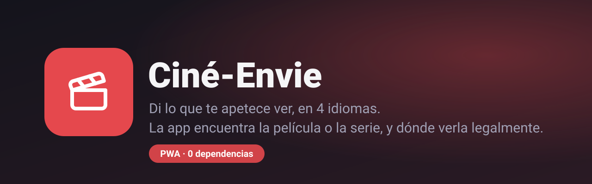
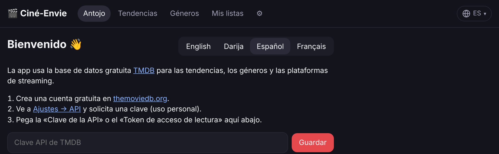
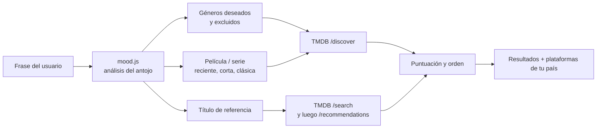

<p align="center"><a href="README.md">English</a> · <a href="README.drj.md">Darija</a> · <a href="README.de.md">Deutsch</a> · <b>Español</b> · <a href="README.fr.md">Français</a> · <a href="README.it.md">Italiano</a> · <a href="README.pt.md">Português</a></p>

<p align="center">
  
</p>

<p align="center">
  <a href="https://rliu-labs.github.io/cine-envie/"><b>▶ Probar la app</b></a>
  ·
  <a href="#funciones">Funciones</a>
  ·
  <a href="#cómo-funciona">Cómo funciona</a>
  ·
  <a href="#seguridad-y-privacidad">Seguridad</a>
  ·
  <a href="#ejecutar-en-local">Ejecutar en local</a>
</p>

<p align="center">
  <a href="https://rliu-labs.github.io/cine-envie/"></a>
  <a href="https://github.com/rliu-labs/cine-envie/actions/workflows/tests.yml"></a>
  
  
  
  <a href="LICENSE"></a>
</p>

---

**Ciné‑Envie** responde a la pregunta de todas las noches: *«¿qué vemos?»*.
Escribes lo que te apetece como se lo dirías a un amigo, **en español, inglés, francés, alemán, italiano, portugués o darija marroquí**, y la app te propone películas y series que encajan, con **dónde verlas legalmente en tu país** (31 países europeos).

> «Una noche tranquila, divertida y con misterio, como Puñales por la espalda»
> → ambiente *tranquila, divertida, misterio* · sin terror ni thriller · parecida a *Puñales por la espalda*

Es una aplicación web instalable (PWA), sin servidor, sin cuenta y sin dependencias: HTML, CSS y JavaScript nativo.

<p align="center">
  
</p>

## Funciones

| | |
|---|---|
| 💬 **Antojo** | Búsqueda en lenguaje natural que entiende el registro coloquial: ambiente, géneros a evitar, película o serie, reciente / corta / clásica y un título de referencia («como Dark», «like Dark», «comme Dark», «b7al Dark»). |
| 🌍 **7 idiomas** | Interfaz y búsqueda en **inglés**, **darija marroquí** (alfabeto latino, con los números 3, 7, 9…), **alemán**, **español**, **francés**, **italiano** y **portugués**. La app se abre en inglés y el idioma se cambia con un clic desde el menú desplegable de la cabecera (globo) o en los ajustes. |
| 📺 **Películas y series** | La búsqueda, los géneros, las tendencias, las notas y las recomendaciones cubren películas y series. En la página de búsqueda, un clic elige **Películas**, **Series** o **Ambas**. |
| 🍿 **Mis plataformas** | En los ajustes, marca tus suscripciones (por defecto Netflix, Prime Video y Disney+; Movistar Plus+, Max… según tu país). Se convierten en botones en la página de búsqueda: «Todas» busca en todas tus plataformas y un clic en una de ellas afina. Tus plataformas también se destacan en cada ficha. |
| 📍 **Tu país** | Elige tu país de residencia entre unos 140 países (Europa, América, África, Oriente Medio, Asia, Oceanía), desde la propia ficha: las plataformas que se muestran son las disponibles donde vives. |
| 🔥 **Tendencias** | Películas y series en tendencia esta semana, con una etiqueta **Nuevo** en lo que ha aparecido desde tu última visita. |
| 🎭 **Géneros** | Explora por género, popularidad o nota. |
| 🎬 **Ficha** | Sinopsis, dirección, reparto con fotos, tráiler dentro de la ficha y ofertas legales del país elegido (suscripción, gratis, alquiler, compra). Toca un actor para ver sus otras películas y series. |
| ⭐ **Perfil de gustos** | Puntúa de 1 a 5 estrellas lo que has visto: la app deduce los géneros que te gustan o evitas, ajusta el orden de cada búsqueda y propone una selección «Recomendado para ti». |
| 📋 **Mis listas** | «Por ver» y «Vistas», guardadas en el navegador, con exportación / importación JSON para cambiar de dispositivo. |
| 📱 **Instalable** | En ordenador (Chrome, Edge), Android e iPhone; la interfaz sigue disponible sin conexión. |
| 🖥️ **Modo TV** | En una smart TV o un dispositivo (Android TV, Google TV, Fire TV, Samsung, LG…), la app pasa sola a una vista grande que se lee desde el sofá y se maneja con el mando: flechas para moverse, OK para abrir, Atrás para cerrar. Se puede forzar en los ajustes (Pantalla: Auto, Móvil / ordenador, TV) o con `?tv=1` en la dirección. |
| 🔎 **Búsqueda por título y por voz** | Busca por ganas o por título, con sugerencias mientras escribes, un botón 🎤 para dictar y **Ver más** bajo cada lista. |
| 📲 **Del móvil a la tele en un escaneo** | Escanea con el móvil el código QR que muestra la tele: recibe tu clave, tus ajustes y tus listas. |
| 🌗 **Tema claro u oscuro** | Auto, claro u oscuro. |
| 🔔 **Avisos de Por ver** | Un aviso te dice cuándo un título de tu lista «Por ver» llega a una de tus plataformas o estrena temporada. |

## Compatible con todas las pantallas

La misma app se adapta al dispositivo, sin configurar nada:

| Dispositivo | Vista y controles | Navegadores probados |
|---|---|---|
| 📱 **Móvil** | Una columna, zonas táctiles grandes, se puede instalar en la pantalla de inicio. | Safari (iPhone), Chrome (Android) |
| 💻 **Ordenador** | Cuadrícula amplia de carteles, ratón o teclado (Tab, Intro, Esc). | Chrome, Edge, Firefox, Safari |
| 🖥️ **TV** | Vista grande que se lee desde el sofá, márgenes contra el recorte de la pantalla, mando: flechas, OK, Atrás. Se activa sola en smart TV y dispositivos de TV. | Samsung (Tizen), LG (webOS), Android TV / Google TV, Fire TV |

Las tabletas usan la vista de móvil o de ordenador según su ancho. Para elegir tú mismo: **Ajustes → Pantalla** (Auto, Móvil / ordenador, TV), o `?tv=1` (o `?tv=0`) en la dirección.

## Compatible con todas las pantallas

La misma app se adapta al dispositivo, sin configurar nada:

| Dispositivo | Vista y controles | Navegadores probados |
|---|---|---|
| 📱 **Móvil** | Una columna, zonas táctiles grandes, se puede instalar en la pantalla de inicio. | Safari (iPhone), Chrome (Android) |
| 💻 **Ordenador** | Cuadrícula amplia de carteles, ratón o teclado (Tab, Intro, Esc). | Chrome, Edge, Firefox, Safari |
| 🖥️ **TV** | Vista grande que se lee desde el sofá, márgenes contra el recorte de la pantalla, mando: flechas, OK, Atrás. Se activa sola en smart TV y dispositivos de TV. | Samsung (Tizen), LG (webOS), Android TV / Google TV, Fire TV |

Las tabletas usan la vista de móvil o de ordenador según su ancho. Para elegir tú mismo: **Ajustes → Pantalla** (Auto, Móvil / ordenador, TV), o `?tv=1` (o `?tv=0`) en la dirección.

## Cómo funciona

El corazón de la app es [`js/mood.js`](js/mood.js): un pequeño analizador de lenguaje natural (español, inglés, francés, alemán, italiano, portugués, darija), sin servicios externos, que convierte una frase en criterios de búsqueda.



Resultados reales del analizador:

| Lo que escribes | Ambiente | Tipo | Excluido | Referencia |
|---|---|---|---|---|
| una noche tranquila, divertida y con misterio | tranquila, divertida, misterio | todo | Terror, Suspense, Bélica | |
| una serie de suspense como Dark | misterio, tensión | serie | | Dark |
| una peli para partirse de risa | divertida | película | | |
| A cozy, funny night with some mystery, like Knives Out | tranquila, divertida, misterio | todo | Terror, Suspense, Bélica | Knives Out |
| I would like something funny | divertida | todo | | *(ninguna: «like» no se toma como título)* |
| soirée cosy, drôle avec de l'intrigue comme À couteaux tirés | tranquila, divertida, misterio | todo | Terror, Suspense, Bélica | À couteaux tirés |
| un bon film de daron | peli de padre | película | | |
| bghit chi film dyal d7k | divertida | película | | |
| msalsal jdid b7al Dark w fih d7k | divertida | serie · reciente | | Dark |

Cada resultado recibe después una puntuación: +3 por género deseado, −6 por género excluido, más la nota y la popularidad, y un extra si viene de las recomendaciones del título de referencia.

En **español**, el analizador entiende también el registro coloquial de España («peli», «partirse de risa», «da yuyu», «de tiros»…), y las fichas de TMDB se muestran en español. El alemán, el italiano y el portugués funcionan igual, con palabras coloquiales de cada idioma («gruselig», «zum Heulen», «giallo», «da sbellicarsi», «miúdos», «porrada»…) y las palabras compuestas alemanas como «Actionfilm».

El **darija** no tiene una ortografía fija en alfabeto latino: el analizador primero normaliza los números-letra (3 → ع, 7 → ح, 9 → ق…) y las letras dobles, y luego reconoce las palabras con patrones flexibles que aceptan variantes («d7k», «dahk», «kaydahek») y prefijos verbales. La interfaz en darija sigue la escritura «arabizi» habitual en Marruecos; le vendría bien una revisión de un hablante nativo, y las sugerencias son bienvenidas. Las fichas de TMDB se muestran entonces en francés.

El **perfil de gustos** se suma a esta puntuación: cada nota da a sus géneros una afinidad entre −1 (1★) y +1 (5★), promediada y suavizada para que una sola película no decida por todas. Todo se calcula en el navegador.

## Arquitectura

```
├── index.html             Estructura de la app
├── style.css              Tema oscuro, diseño adaptable
├── js/
│   ├── app.js             Vistas, navegación por hash, ficha detallada
│   ├── mood.js            Análisis del antojo y puntuación (JS puro, con tests)
│   ├── i18n.js            Textos en los 7 idiomas, países europeos, detección de idioma y país
│   ├── tmdb.js            Cliente de la API de TMDB (idioma y país configurables, caché en memoria)
│   └── store.js           Almacenamiento local: idioma, país, clave, listas, notas, última visita
├── sw.js                  Service worker (interfaz sin conexión, caché de carteles)
├── manifest.webmanifest   Manifiesto PWA
├── icons/                 Icono de la app, logo de TMDB
├── scripts/captures.mjs   Genera las capturas y el GIF del README (Playwright)
└── tests/                 Tests node:test (analizador, perfil, traducciones, cliente TMDB)
```

**Decisiones técnicas**
- **Sin compilación ni dependencias**: módulos ES nativos, servidos tal cual por GitHub Pages.
- **Clave v3 o token v4**: el cliente detecta el formato y usa el parámetro `api_key` o la cabecera `Bearer`.
- **Service worker «primero la red»**: las actualizaciones llegan al momento y la caché toma el relevo sin conexión.

## Seguridad y privacidad

Ciné‑Envie está pensado para no saber nada de ti.

| | |
|---|---|
| 🖥️ **Sin servidor** | Sitio 100 % estático alojado en GitHub Pages, servido por HTTPS. |
| 🔑 **Tu clave se queda contigo** | La clave de TMDB se guarda en tu navegador y solo se envía a la API de TMDB. |
| 🙈 **Sin rastreo** | Sin estadísticas, publicidad ni cookies. |
| 🌐 **Lo que contacta tu navegador** | TMDB (datos e imágenes) y GitHub Pages, que aloja la app y puede registrar tu dirección IP. Los tráileres se abren en YouTube. |
| 📲 **Transferencia y voz** | La transferencia móvil → tele va cifrada por un relé público que no puede leerla; el dictado usa el servicio de voz del navegador. Detalles en la nota de privacidad de la app (pie de página). |
| 📦 **Cero dependencias** | La página no carga ningún paquete npm ni script externo: nada que pueda comprometerse desde fuera. (Los únicos paquetes npm sirven para generar las capturas, nunca los usa la app.) |
| 🛡️ **Content Security Policy** | El navegador bloquea cualquier script ajeno y cualquier conexión fuera de TMDB y del relé ntfy.sh. |
| 🧹 **Datos escapados** | Todo lo que viene de TMDB o de una importación se neutraliza antes de mostrarse. |

¿Has encontrado un fallo de seguridad? Consulta [SECURITY.md](SECURITY.md) para avisar en privado.

## Ejecutar en local

```bash
git clone https://github.com/rliu-labs/cine-envie.git
cd cine-envie
python3 -m http.server 8000   # o: npm start
```

Abre http://localhost:8000 y pega tu clave de TMDB (gratuita: themoviedb.org → Ajustes → API).

Tests:

```bash
npm test
```

Capturas y GIF de demostración con datos reales (necesita tu clave de TMDB):

```bash
npm install
npx playwright install chromium
TMDB_KEY=tu_clave npm run captures   # resultado en docs/captures/
```

Las ideas son bienvenidas: consulta [CONTRIBUTING.md](CONTRIBUTING.md).

## Créditos

<a href="https://www.themoviedb.org/"></a>

Datos e imágenes de películas y series: [TMDB](https://www.themoviedb.org/).
*This product uses the TMDB API but is not endorsed or certified by TMDB.*

Disponibilidad en streaming: [JustWatch](https://www.justwatch.com/), a través de la API de TMDB.

Icono: pictograma «clapperboard» de [Lucide](https://lucide.dev) (licencia ISC, ver [icons/LICENSE-lucide.txt](icons/LICENSE-lucide.txt)).

Netflix, Prime Video, Disney+ y los demás nombres y logotipos de plataformas son marcas de sus respectivos propietarios. Ciné‑Envie no está afiliado a ninguno de estos servicios, ni a TMDB o JustWatch.

Aviso legal: proyecto personal, gratuito y sin fines comerciales, publicado por rliu-labs y alojado por GitHub, Inc. (88 Colin P. Kelly Jr. Street, San Francisco, CA 94107, EE. UU.). Contacto: [issues de GitHub](https://github.com/rliu-labs/cine-envie/issues).

Código bajo licencia [MIT](LICENSE).
