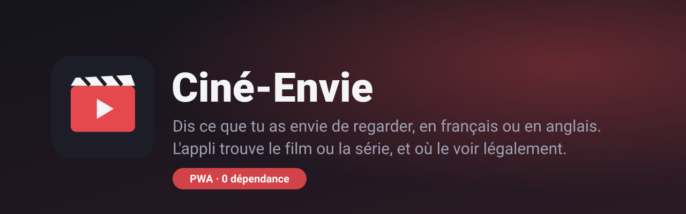
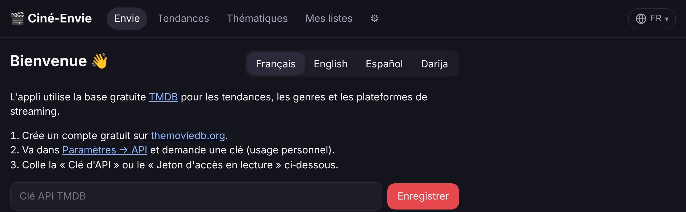
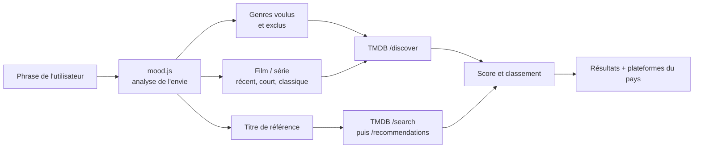

<p align="center"><a href="README.md">English</a> · <a href="README.drj.md">Darija</a> · <a href="README.de.md">Deutsch</a> · <a href="README.es.md">Español</a> · <b>Français</b> · <a href="README.it.md">Italiano</a> · <a href="README.pt.md">Português</a></p>

<p align="center">
  
</p>

<p align="center">
  <a href="https://rliu-labs.github.io/cine-envie/"><b>▶ Essayer l'appli</b></a>
  ·
  <a href="#fonctionnalités">Fonctionnalités</a>
  ·
  <a href="#comment-ça-marche">Comment ça marche</a>
  ·
  <a href="#sécurité-et-vie-privée">Sécurité</a>
  ·
  <a href="#lancer-en-local">Lancer en local</a>
</p>

<p align="center">
  <a href="https://rliu-labs.github.io/cine-envie/"></a>
  <a href="https://github.com/rliu-labs/cine-envie/actions/workflows/tests.yml"></a>
  
  
  
  <a href="LICENSE"></a>
</p>

---

**Ciné‑Envie** répond à la question de tous les soirs : *« on regarde quoi ? »*.
Tu écris ton envie comme tu la dirais à un ami, **en français, anglais, espagnol, allemand, italien, portugais ou darija marocain**, et l'appli propose des films et séries qui collent, avec **où les regarder légalement dans ton pays** (31 pays européens).

> « soirée cosy, drôle avec de l'intrigue comme À couteaux tirés »
> → humeurs *cosy, drôle, intrigue* · pas d'horreur ni de thriller · proche de *À couteaux tirés*

C'est une application web installable (PWA), sans serveur, sans compte, sans dépendance : du HTML, du CSS et du JavaScript natif.

<p align="center">
  
</p>

## Fonctionnalités

| | |
|---|---|
| 💬 **Envie** | Recherche en langage naturel, langage familier compris : humeurs, genres à éviter, film ou série, récent / court / classique, titre de référence (« comme Dark », « like Dark », « como Dark », « b7al Dark »). |
| 🌍 **7 langues** | Interface et recherche en **anglais**, **darija marocain** (lettres latines, avec les chiffres 3, 7, 9…), **allemand**, **espagnol**, **français**, **italien** et **portugais**. L’appli s’ouvre en anglais, et la langue se change en un clic depuis le menu déroulant de l’en-tête (globe) ou dans les réglages. |
| 📺 **Films et séries** | Recherche, thématiques, tendances, notes et recommandations couvrent films et séries. Sur la page de recherche, un clic choisit **Films**, **Séries** ou **Les deux**. |
| 🍿 **Mes plateformes** | Dans les réglages, coche tes abonnements (par défaut Netflix, Prime Video et Disney+ ; Canal+, Max… selon ton pays). Ils deviennent des boutons sur la page de recherche : « Toutes » cherche sur l'ensemble de tes plateformes, un clic sur l'une d'elles affine. Tes plateformes sont aussi mises en avant dans chaque fiche. |
| 📍 **Ton pays** | Choix du pays de résidence parmi 31 pays européens, directement depuis la fiche : les plateformes affichées sont celles disponibles chez toi. |
| 🔥 **Tendances** | Films et séries tendance de la semaine, avec un badge **Nouveau** sur ce qui est apparu depuis ta dernière visite. |
| 🎭 **Thématiques** | Parcours par genre, par popularité ou par note. |
| 🎬 **Fiche** | Résumé, réalisateur, casting, bande‑annonce et plateformes légales du pays choisi (abonnement, gratuit, location, achat). |
| ⭐ **Profil de goûts** | Note les titres vus de 1 à 5 étoiles : l'appli en déduit les genres que tu aimes ou évites, ajuste le classement de chaque recherche et propose une sélection « Recommandé pour toi ». |
| 📋 **Mes listes** | « À voir » et « Vus », stockés dans le navigateur, avec export / import JSON pour changer d'appareil. |
| 📱 **Installable** | Sur ordinateur (Chrome, Edge), Android et iPhone ; l'interface reste disponible hors ligne. |
| 🖥️ **Mode TV** | Sur une télé connectée ou un boîtier (Android TV, Google TV, Fire TV, Samsung, LG…), l'appli passe toute seule en grand affichage lisible depuis le canapé, et se pilote à la télécommande : flèches pour se déplacer, OK pour ouvrir, Retour pour fermer. On peut le forcer dans les réglages (Affichage : Auto, Téléphone / ordinateur, TV) ou avec `?tv=1` dans l'adresse. |
| 🔎 **Recherche par titre, suggestions et voix** | Recherche par envie ou par titre exact, avec des suggestions pendant la frappe (idées toutes faites ou titres avec leur affiche). Là où le navigateur le permet (Chrome, Edge, Safari), un bouton 🎤 permet de dire ce qu'on veut. Chaque liste se termine par un bouton **Voir plus**. |
| 📲 **Du téléphone à la télé en un scan** | La télé affiche un QR code : scanne-le avec le téléphone où l'appli est déjà réglée, confirme, et la télé reçoit ta clé TMDB, tes réglages et tes listes. Rien à taper à la télécommande. |
| 🌗 **Thème clair ou sombre** | Auto (comme l'appareil), clair ou sombre, dans les réglages. Photos des acteurs sur chaque fiche. |

## Compatible avec tous les écrans

La même appli s'adapte à l'appareil, sans rien régler :

| Appareil | Affichage et commandes | Navigateurs testés |
|---|---|---|
| 📱 **Téléphone** | Une colonne, grandes zones à toucher, installable sur l'écran d'accueil. | Safari (iPhone), Chrome (Android) |
| 💻 **Ordinateur** | Grande grille d'affiches, souris ou clavier (Tab, Entrée, Échap). | Chrome, Edge, Firefox, Safari |
| 🖥️ **TV** | Grand affichage lisible depuis le canapé, marges contre le rognage de l'écran, télécommande : flèches, OK, Retour. S'active tout seul sur les télés connectées et les boîtiers. | Samsung (Tizen), LG (webOS), Android TV / Google TV, Fire TV |

Les tablettes prennent l'affichage téléphone ou ordinateur selon leur largeur. Pour choisir soi-même : **Réglages → Affichage** (Auto, Téléphone / ordinateur, TV), ou `?tv=1` (ou `?tv=0`) dans l'adresse.

## Compatible avec tous les écrans

La même appli s'adapte à l'appareil, sans rien régler :

| Appareil | Affichage et commandes | Navigateurs testés |
|---|---|---|
| 📱 **Téléphone** | Une colonne, grandes zones à toucher, installable sur l'écran d'accueil. | Safari (iPhone), Chrome (Android) |
| 💻 **Ordinateur** | Grande grille d'affiches, souris ou clavier (Tab, Entrée, Échap). | Chrome, Edge, Firefox, Safari |
| 🖥️ **TV** | Grand affichage lisible depuis le canapé, marges contre le rognage de l'écran, télécommande : flèches, OK, Retour. S'active tout seul sur les télés connectées et les boîtiers. | Samsung (Tizen), LG (webOS), Android TV / Google TV, Fire TV |

Les tablettes prennent l'affichage téléphone ou ordinateur selon leur largeur. Pour choisir soi-même : **Réglages → Affichage** (Auto, Téléphone / ordinateur, TV), ou `?tv=1` (ou `?tv=0`) dans l'adresse.

## Comment ça marche

Le cœur de l'appli est [`js/mood.js`](js/mood.js) : un petit analyseur de langage naturel (français, anglais, espagnol, allemand, italien, portugais, darija), sans service externe, qui transforme une phrase en critères de recherche.



Exemples réels de sortie de l'analyseur :

| Ce que tu écris | Humeurs | Type | Exclu | Référence |
|---|---|---|---|---|
| soirée cosy, drôle avec de l'intrigue comme À couteaux tirés | cosy, drôle, intrigue | tout | Horreur, Thriller, Guerre | À couteaux tirés |
| un film d'action récent qui ne se prend pas au sérieux | action | film · récent | | |
| une série à suspense comme Dark | intrigue | série | | Dark |
| film familial pour dimanche soir | famille | film | Horreur | |
| de la SF qui fait réfléchir comme Interstellar | SF | tout | | Interstellar |
| A cozy, funny night with some mystery, like Knives Out | cosy, drôle, intrigue | tout | Horreur, Thriller, Guerre | Knives Out |
| a classic 90s thriller | tension | tout · classique | | |
| I would like something funny | drôle | tout | | *(aucune : « like » n'est pas pris pour un titre)* |
| un truc qui fout les jetons | frissons | tout | | |
| un bon film de daron | film de daron | film | | |
| une série à binger qui me retourne le cerveau | intrigue | série | | |
| un truc chill sous la couette | cosy | tout | Horreur, Thriller, Guerre | |
| bghit chi film dyal d7k | drôle | film | | |
| msalsal jdid b7al Dark w fih d7k | drôle | série · récent | | Dark |
| soirée cosy, film dyal d7k w l7ob | cosy, drôle, romance | film | Horreur, Thriller, Guerre | |
| una serie de suspense como Dark | intrigue, tension | série | | Dark |
| una peli para partirse de risa | drôle | film | | |
| una noche tranquila, divertida y con misterio | cosy, drôle, intrigue | tout | Horreur, Thriller, Guerre | |

Chaque résultat reçoit ensuite un score : +3 par genre voulu, −6 par genre exclu, plus la note et la popularité, et un bonus s'il vient des recommandations du titre de référence.

En **espagnol**, l'analyseur comprend aussi le registre familier d'Espagne (« peli », « partirse de risa », « da yuyu », « de tiros »…), et les fiches TMDB s'affichent en espagnol. L'allemand, l'italien et le portugais fonctionnent de la même façon, avec des mots courants de chaque langue (« gruselig », « zum Heulen », « giallo », « da sbellicarsi », « miúdos », « porrada »…) et les mots composés allemands comme « Actionfilm ».

Le **darija** n'a pas d'orthographe fixe en lettres latines : l'analyseur replie d'abord les chiffres-lettres (3 → ع, 7 → ح, 9 → ق…) et les lettres doublées, puis reconnaît les mots avec des motifs souples qui acceptent les variantes (« d7k », « dahk », « kaydahek ») et les préfixes verbaux. L'interface en darija suit la graphie « arabizi » courante au Maroc ; elle mériterait une relecture par un locuteur natif, et les suggestions sont les bienvenues. Les fiches TMDB (titres, résumés) s'affichent alors en français.

Le **profil de goûts** s'ajoute à ce score : chaque note donne à ses genres une affinité entre −1 (1★) et +1 (5★), moyennée et lissée pour qu'un seul film ne fasse pas la loi. Tout est calculé dans le navigateur.

## Architecture

```
├── index.html             Coquille de l'appli
├── style.css              Thème sombre, mise en page responsive
├── js/
│   ├── app.js             Vues, navigation par hash, fiche détaillée
│   ├── mood.js            Analyse de l'envie et score (pur JS, testé)
│   ├── i18n.js            Textes dans les 7 langues, pays européens, détection langue et pays
│   ├── tmdb.js            Client API TMDB (langue et pays réglables, cache mémoire)
│   └── store.js           Stockage local : langue, pays, clé, listes, notes, veille
├── sw.js                  Service worker (interface hors ligne, cache des affiches)
├── manifest.webmanifest   Manifeste PWA
├── icons/                 Icône de l'appli, logo TMDB
├── scripts/captures.mjs   Génère les captures et le GIF du README (Playwright)
└── tests/                 Tests node:test (analyseur, profil, traductions, client TMDB)
```

**Choix techniques**
- **Zéro build, zéro dépendance** : modules ES natifs, servis tels quels par GitHub Pages.
- **Clé v3 ou jeton v4** : le client détecte le format et utilise le paramètre `api_key` ou l'en‑tête `Bearer`.
- **Service worker « réseau d'abord »** : les mises à jour arrivent tout de suite, le cache prend le relais hors ligne.

## Sécurité et vie privée

Ciné‑Envie est conçu pour ne rien savoir de toi.

| | |
|---|---|
| 🖥️ **Aucun serveur** | Site 100 % statique hébergé sur GitHub Pages, servi en HTTPS. |
| 🔑 **Ta clé reste chez toi** | La clé TMDB est stockée dans ton navigateur et envoyée uniquement à l'API TMDB. |
| 🙈 **Aucun pistage** | Pas de statistiques, de publicité ni de cookies. |
| 🌐 **Ce que ton navigateur contacte** | TMDB (données et images) et GitHub Pages, qui héberge l'appli et peut enregistrer ton adresse IP. Les bandes-annonces s'ouvrent sur YouTube. |
| 📲 **Transfert par QR code** | Seulement si tu l'utilises : les données sont chiffrées dans ton navigateur (AES-GCM) et passent par le relais public ntfy.sh, qui ne peut pas les lire (la clé reste dans le QR code) et les efface sous 12 h. La recherche vocale envoie le son au service de reconnaissance du navigateur (Google pour Chrome, Apple pour Safari). |
| 📦 **Zéro dépendance** | La page ne charge aucun paquet npm ni script externe : rien qui puisse être compromis en amont. (Les seuls paquets npm servent à générer les captures, jamais à l'appli.) |
| 🛡️ **Content Security Policy** | Le navigateur bloque tout script étranger et toute connexion hors de TMDB et du relais ntfy.sh. |
| 🧹 **Données échappées** | Tout ce qui vient de TMDB ou d'un import est neutralisé avant affichage. |

Une faille ? Voir [SECURITY.md](SECURITY.md) pour la signaler en privé.

## Lancer en local

```bash
git clone https://github.com/rliu-labs/cine-envie.git
cd cine-envie
python3 -m http.server 8000   # ou : npm start
```

Ouvre http://localhost:8000 et colle ta clé TMDB (gratuite : themoviedb.org → Paramètres → API).

Tests :

```bash
npm test
```

Captures d'écran et GIF de démonstration, avec de vraies données (nécessite ta clé TMDB) :

```bash
npm install
npx playwright install chromium
TMDB_KEY=ta_cle npm run captures   # résultat dans docs/captures/
```

Les idées sont bienvenues : voir [CONTRIBUTING.md](CONTRIBUTING.md).

## Crédits

<a href="https://www.themoviedb.org/"></a>

Données et images de films et séries : [TMDB](https://www.themoviedb.org/).
*This product uses the TMDB API but is not endorsed or certified by TMDB.*

Disponibilités streaming : [JustWatch](https://www.justwatch.com/), via l'API TMDB.

Icône : pictogramme « clapperboard » de [Lucide](https://lucide.dev) (licence ISC, voir [icons/LICENSE-lucide.txt](icons/LICENSE-lucide.txt)).

Netflix, Prime Video, Disney+ et les autres noms et logos de plateformes sont des marques de leurs propriétaires. Ciné‑Envie n'est affilié à aucun de ces services, ni à TMDB ou JustWatch.

Mentions légales : projet personnel, gratuit et non commercial, publié par rliu-labs et hébergé par GitHub, Inc. (88 Colin P. Kelly Jr. Street, San Francisco, CA 94107, États-Unis). Contact : [issues GitHub](https://github.com/rliu-labs/cine-envie/issues).

Code sous licence [MIT](LICENSE).
