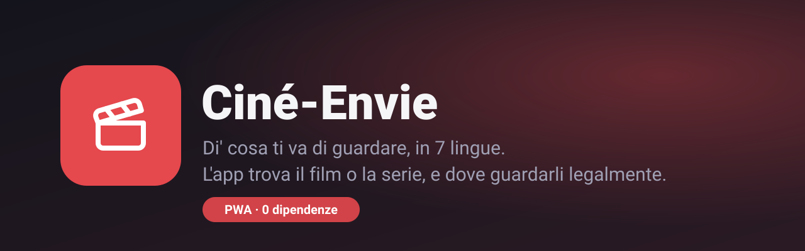
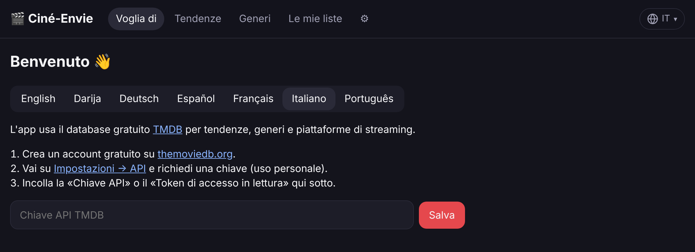
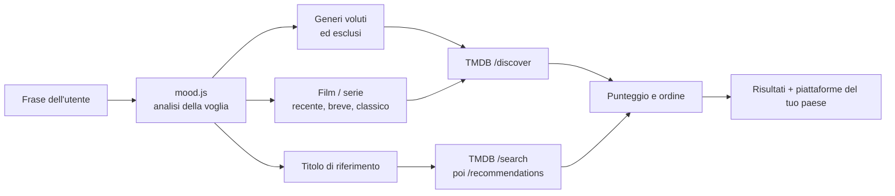

<p align="center"><a href="README.md">English</a> · <a href="README.drj.md">Darija</a> · <a href="README.de.md">Deutsch</a> · <a href="README.es.md">Español</a> · <a href="README.fr.md">Français</a> · <b>Italiano</b> · <a href="README.pt.md">Português</a></p>

<p align="center">
  
</p>

<p align="center">
  <a href="https://rliu-labs.github.io/cine-envie/"><b>▶ Prova l'app</b></a>
  ·
  <a href="#funzionalità">Funzionalità</a>
  ·
  <a href="#come-funziona">Come funziona</a>
  ·
  <a href="#sicurezza-e-privacy">Sicurezza</a>
  ·
  <a href="#avvio-in-locale">Avvio in locale</a>
</p>

<p align="center">
  <a href="https://rliu-labs.github.io/cine-envie/"></a>
  <a href="https://github.com/rliu-labs/cine-envie/actions/workflows/tests.yml"></a>
  
  
  
  <a href="LICENSE"></a>
</p>

---

**Ciné‑Envie** risponde alla domanda di ogni sera: *«cosa guardiamo?»*.
Scrivi cosa ti va di vedere come lo diresti a un amico, **in italiano, inglese, francese, spagnolo, tedesco, portoghese o darija marocchino**, e l'app ti propone film e serie adatti, con **dove guardarli legalmente nel tuo paese** (31 paesi europei).

> «Una serata rilassante, divertente e con un po' di mistero, come Cena con delitto»
> → umore *rilassante, divertente, mistero* · niente horror né thriller · simile a *Cena con delitto*

È un'app web installabile (PWA), senza server, senza account e senza dipendenze: HTML, CSS e JavaScript nativo.

<p align="center">
  
</p>

## Funzionalità

| | |
|---|---|
| 💬 **Voglia di** | Ricerca in linguaggio naturale, anche colloquiale: umore, generi da evitare, film o serie, recente / breve / classico e un titolo di riferimento («come Dark», «like Dark», «comme Dark», «wie Dark»). |
| 🌍 **7 lingue** | Interfaccia e ricerca in **inglese**, **darija** (marocchino, in alfabeto latino con le cifre 3, 7, 9…), **tedesco**, **spagnolo**, **francese**, **italiano** e **portoghese**. L'app si apre in inglese e la lingua si cambia con un clic dal menu in alto (globo) o nelle impostazioni. |
| 📺 **Film e serie** | Ricerca, generi, tendenze, voti e consigli coprono film e serie. Nella pagina di ricerca un clic sceglie **Film**, **Serie** o **Entrambi**. |
| 🍿 **Le mie piattaforme** | Nelle impostazioni spunta i tuoi abbonamenti (di default Netflix, Prime Video e Disney+; NOW, Infinity… a seconda del paese). Diventano pulsanti nella pagina di ricerca: «Tutte» cerca su tutte le tue piattaforme, un clic su una di esse restringe la ricerca. Le tue piattaforme sono evidenziate anche in ogni scheda. |
| 📍 **Il tuo paese** | Scegli il paese di residenza tra circa 140 paesi (Europa, Americhe, Africa, Medio Oriente, Asia, Oceania), direttamente dalla scheda: le piattaforme mostrate sono quelle disponibili da te. |
| 🔥 **Tendenze** | Film e serie di tendenza della settimana, con un badge **Nuovo** su ciò che è apparso dalla tua ultima visita. |
| 🎭 **Generi** | Esplora per genere, popolarità o voto. |
| 🎬 **Scheda** | Trama, regia, cast con foto, trailer nella scheda e offerte legali del paese scelto (abbonamento, gratis, noleggio, acquisto). Tocca un attore per vedere i suoi altri film e serie. |
| ⭐ **Profilo dei gusti** | Vota da 1 a 5 stelle ciò che hai visto: l'app capisce quali generi ami o eviti, adatta l'ordine di ogni ricerca e propone una selezione «Consigliati per te». |
| 📋 **Le mie liste** | «Da vedere» e «Visti», salvati nel browser, con esportazione / importazione JSON per cambiare dispositivo. |
| 📱 **Installabile** | Su computer (Chrome, Edge), Android e iPhone; l'interfaccia resta disponibile offline. |
| 🖥️ **Modalità TV** | Su una smart TV o un box (Android TV, Google TV, Fire TV, Samsung, LG…) l'app passa da sola a una vista grande leggibile dal divano e si usa con il telecomando: frecce per spostarsi, OK per aprire, Indietro per chiudere. Si può forzare nelle impostazioni (Visualizzazione: Auto, Telefono / computer, TV) o con `?tv=1` nell'indirizzo. |
| 🔎 **Ricerca per titolo e a voce** | Cerca per voglia o per titolo, con suggerimenti mentre scrivi, un pulsante 🎤 per dettare e **Mostra altri** sotto ogni lista. |
| 📲 **Dal telefono alla TV con una scansione** | Inquadra col telefono il codice QR mostrato dalla TV: riceve chiave, impostazioni e liste. |
| 🌗 **Tema chiaro o scuro** | Auto, chiaro o scuro. |
| 🔔 **Avvisi Da vedere** | Un avviso ti dice quando un titolo della lista «Da vedere» arriva su una delle tue piattaforme o ha una nuova stagione. |

## Compatibile con ogni schermo

La stessa app si adatta al dispositivo, senza impostare nulla:

| Dispositivo | Vista e comandi | Browser provati |
|---|---|---|
| 📱 **Telefono** | Una colonna, grandi aree da toccare, installabile nella schermata Home. | Safari (iPhone), Chrome (Android) |
| 💻 **Computer** | Ampia griglia di locandine, mouse o tastiera (Tab, Invio, Esc). | Chrome, Edge, Firefox, Safari |
| 🖥️ **TV** | Vista grande leggibile dal divano, margini contro il ritaglio dello schermo, telecomando: frecce, OK, Indietro. Si attiva da sola su smart TV e box TV. | Samsung (Tizen), LG (webOS), Android TV / Google TV, Fire TV |

I tablet usano la vista telefono o computer secondo la larghezza. Per scegliere tu: **Impostazioni → Visualizzazione** (Auto, Telefono / computer, TV), oppure `?tv=1` (o `?tv=0`) nell'indirizzo.

## Compatibile con ogni schermo

La stessa app si adatta al dispositivo, senza impostare nulla:

| Dispositivo | Vista e comandi | Browser provati |
|---|---|---|
| 📱 **Telefono** | Una colonna, grandi aree da toccare, installabile nella schermata Home. | Safari (iPhone), Chrome (Android) |
| 💻 **Computer** | Ampia griglia di locandine, mouse o tastiera (Tab, Invio, Esc). | Chrome, Edge, Firefox, Safari |
| 🖥️ **TV** | Vista grande leggibile dal divano, margini contro il ritaglio dello schermo, telecomando: frecce, OK, Indietro. Si attiva da sola su smart TV e box TV. | Samsung (Tizen), LG (webOS), Android TV / Google TV, Fire TV |

I tablet usano la vista telefono o computer secondo la larghezza. Per scegliere tu: **Impostazioni → Visualizzazione** (Auto, Telefono / computer, TV), oppure `?tv=1` (o `?tv=0`) nell'indirizzo.

## Come funziona

Il cuore dell'app è [`js/mood.js`](js/mood.js): un piccolo analizzatore di linguaggio naturale (inglese, italiano, francese, spagnolo, tedesco, portoghese, darija), senza servizi esterni, che trasforma una frase in criteri di ricerca.



Risultati reali dell'analizzatore:

| Cosa scrivi | Umore | Tipo | Escluso | Riferimento |
|---|---|---|---|---|
| una serata rilassante, divertente e con un po' di mistero, come Cena con delitto | rilassante, divertente, mistero | tutto | Horror, Thriller, Guerra | Cena con delitto |
| un film d'azione recente | azione | film · recente | | |
| una serie di suspense come Dark | mistero, tensione | serie | | Dark |
| qualcosa da sbellicarsi con i bambini | divertente, famiglia | tutto | Horror | |
| A cozy, funny night with some mystery, like Knives Out | rilassante, divertente, mistero | tutto | Horror, Thriller, Guerra | Knives Out |
| ein neuer Actionfilm, der sich nicht zu ernst nimmt | azione | film · recente | | |
| bghit chi film dyal d7k | divertente | film | | |

Ogni risultato riceve poi un punteggio: +3 per ogni genere voluto, −6 per ogni genere escluso, più voto e popolarità, e un bonus se arriva dai consigli del titolo di riferimento.

In **italiano** l'analizzatore capisce anche il registro colloquiale («giallo», «da sbellicarsi», «strappalacrime», «mazzate»…), e le schede TMDB appaiono in italiano. Tedesco, portoghese e spagnolo funzionano allo stesso modo.

Il **darija** non ha un'ortografia fissa in alfabeto latino: l'analizzatore normalizza prima le cifre-lettera (3 → ع, 7 → ح, 9 → ق…) e le lettere doppie, poi riconosce le parole con schemi flessibili che accettano le varianti («d7k», «dahk», «kaydahek») e i prefissi verbali. L'interfaccia in darija segue la grafia «arabizi» diffusa in Marocco; andrebbe riletta da un madrelingua, e i suggerimenti sono benvenuti. Le schede TMDB appaiono allora in francese.

Il **profilo dei gusti** si aggiunge a questo punteggio: ogni voto dà ai suoi generi un'affinità tra −1 (1★) e +1 (5★), mediata e smussata perché un solo film non decida tutto. Tutto è calcolato nel browser.

## Architettura

```
├── index.html             Struttura dell'app
├── style.css              Tema scuro, layout responsive
├── js/
│   ├── app.js             Viste, navigazione con hash, scheda dettagliata
│   ├── mood.js            Analisi della voglia e punteggio (JS puro, testato)
│   ├── i18n.js            Testi in 7 lingue, paesi europei, rilevamento del paese
│   ├── tmdb.js            Client API TMDB (lingua e paese configurabili, cache in memoria)
│   └── store.js           Archiviazione locale: lingua, paese, chiave, liste, voti, ultima visita
├── sw.js                  Service worker (interfaccia offline, cache delle locandine)
├── manifest.webmanifest   Manifest PWA
├── icons/                 Icona dell'app, logo TMDB
├── scripts/captures.mjs   Genera gli screenshot e la GIF del README (Playwright)
└── tests/                 Test node:test (analizzatore, profilo, traduzioni, client TMDB)
```

**Scelte tecniche**
- **Niente build, niente dipendenze**: moduli ES nativi, serviti così come sono da GitHub Pages.
- **Chiave v3 o token v4**: il client riconosce il formato e usa il parametro `api_key` o l'intestazione `Bearer`.
- **Service worker «prima la rete»**: gli aggiornamenti arrivano subito e la cache subentra offline.

## Sicurezza e privacy

Ciné‑Envie è pensata per non sapere niente di te.

| | |
|---|---|
| 🖥️ **Nessun server** | Sito 100% statico ospitato su GitHub Pages, servito in HTTPS. |
| 🔑 **La tua chiave resta tua** | La chiave TMDB è salvata nel tuo browser e inviata solo all'API di TMDB. |
| 🙈 **Nessun tracciamento** | Niente statistiche, pubblicità o cookie. |
| 🌐 **Cosa contatta il tuo browser** | TMDB (dati e immagini) e GitHub Pages, che ospita l'app e può registrare il tuo indirizzo IP. I trailer si aprono su YouTube. |
| 📲 **Trasferimento e voce** | Il trasferimento telefono → TV è cifrato e passa da un relè pubblico che non può leggerlo; la dettatura usa il servizio vocale del browser. Dettagli nella nota sulla privacy dell'app (piè di pagina). |
| 📦 **Zero dipendenze** | La pagina non carica pacchetti npm né script esterni: niente che possa essere compromesso a monte. (Gli unici pacchetti npm servono a generare gli screenshot, mai all'app.) |
| 🛡️ **Content Security Policy** | Il browser blocca qualsiasi script estraneo e qualsiasi connessione fuori da TMDB e dal relè ntfy.sh. |
| 🧹 **Dati neutralizzati** | Tutto ciò che arriva da TMDB o da un'importazione viene neutralizzato prima di essere mostrato. |

Hai trovato una vulnerabilità? Leggi [SECURITY.md](SECURITY.md) per segnalarla in privato.

## Avvio in locale

```bash
git clone https://github.com/rliu-labs/cine-envie.git
cd cine-envie
python3 -m http.server 8000   # oppure: npm start
```

Apri http://localhost:8000 e incolla la tua chiave TMDB (gratuita: themoviedb.org → Impostazioni → API).

Test:

```bash
npm test
```

Screenshot e GIF dimostrativa con dati reali (serve la tua chiave TMDB):

```bash
npm install
npx playwright install chromium
TMDB_KEY=la_tua_chiave npm run captures   # risultato in docs/captures/
```

Le idee sono benvenute: vedi [CONTRIBUTING.md](CONTRIBUTING.md).

## Crediti

<a href="https://www.themoviedb.org/"></a>

Dati e immagini di film e serie: [TMDB](https://www.themoviedb.org/).
*This product uses the TMDB API but is not endorsed or certified by TMDB.*

Disponibilità in streaming: [JustWatch](https://www.justwatch.com/), tramite l'API di TMDB.

Icona: pittogramma «clapperboard» di [Lucide](https://lucide.dev) (licenza ISC, vedi [icons/LICENSE-lucide.txt](icons/LICENSE-lucide.txt)).

Netflix, Prime Video, Disney+ e gli altri nomi e loghi delle piattaforme sono marchi dei rispettivi proprietari. Ciné‑Envie non è affiliato a nessuno di questi servizi, né a TMDB o JustWatch.

Note legali: progetto personale, gratuito e non commerciale, pubblicato da rliu-labs e ospitato da GitHub, Inc. (88 Colin P. Kelly Jr. Street, San Francisco, CA 94107, USA). Contatto: [issue su GitHub](https://github.com/rliu-labs/cine-envie/issues).

Codice con licenza [MIT](LICENSE).
