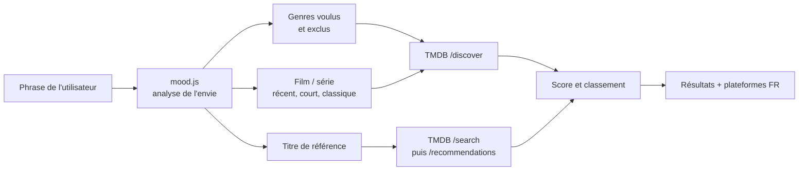

<p align="center">
  
</p>

<p align="center">
  <a href="https://rliu-labs.github.io/cine-envie/"><b>▶ Essayer l'appli</b></a>
  ·
  <a href="#fonctionnalités">Fonctionnalités</a>
  ·
  <a href="#comment-ça-marche">Comment ça marche</a>
  ·
  <a href="#lancer-en-local">Lancer en local</a>
</p>

<p align="center">
  <a href="https://rliu-labs.github.io/cine-envie/"></a>
  <a href="https://github.com/rliu-labs/cine-envie/actions/workflows/tests.yml"></a>
  
  
  
  <a href="LICENSE"></a>
</p>

---

**Ciné‑Envie** répond à la question de tous les soirs : *« on regarde quoi ? »*.
Tu écris ton envie comme tu la dirais à un ami, et l'appli propose des films et séries qui collent, avec **où les regarder légalement en France**.

> « soirée cosy, drôle avec de l'intrigue comme À couteaux tirés »
> → humeurs *cosy, drôle, intrigue* · pas d'horreur ni de thriller · proche de *À couteaux tirés*

C'est une application web installable (PWA), sans serveur, sans compte, sans dépendance : du HTML, du CSS et du JavaScript natif.

<p align="center">
  
</p>

## Fonctionnalités

| | |
|---|---|
| 💬 **Envie** | Recherche en langage naturel : humeurs, genres à éviter, film ou série, récent / court / classique, titre de référence (« comme Dark »). |
| 🔥 **Tendances** | Films et séries tendance de la semaine, avec un badge **Nouveau** sur ce qui est apparu depuis ta dernière visite. |
| 🎭 **Thématiques** | Parcours par genre, par popularité ou par note. |
| 🎬 **Fiche** | Résumé, réalisateur, casting, bande‑annonce et plateformes françaises (abonnement, gratuit, location, achat). |
| 📋 **Mes listes** | « À voir » et « Vus », stockés dans le navigateur, avec export / import JSON pour changer d'appareil. |
| 📱 **Installable** | Sur ordinateur (Chrome, Edge), Android et iPhone ; l'interface reste disponible hors ligne. |

## Comment ça marche

Le cœur de l'appli est [`js/mood.js`](js/mood.js) : un petit analyseur de langage naturel, sans IA ni service externe, qui transforme une phrase en critères de recherche.



Exemples réels de sortie de l'analyseur :

| Ce que tu écris | Humeurs | Type | Exclu | Référence |
|---|---|---|---|---|
| soirée cosy, drôle avec de l'intrigue comme À couteaux tirés | cosy, drôle, intrigue | tout | Horreur, Thriller, Guerre | À couteaux tirés |
| un film d'action récent qui ne se prend pas au sérieux | action | film · récent | | |
| une série à suspense comme Dark | intrigue | série | | Dark |
| film familial pour dimanche soir | famille | film | Horreur | |
| de la SF qui fait réfléchir comme Interstellar | SF | tout | | Interstellar |

Chaque résultat reçoit ensuite un score : +3 par genre voulu, −6 par genre exclu, plus la note et la popularité, et un bonus s'il vient des recommandations du titre de référence.

## Architecture

```
├── index.html             Coquille de l'appli
├── style.css              Thème sombre, mise en page responsive
├── js/
│   ├── app.js             Vues, navigation par hash, fiche détaillée
│   ├── mood.js            Analyse de l'envie et score (pur JS, testé)
│   ├── tmdb.js            Client API TMDB (fr‑FR, région FR, cache mémoire)
│   └── store.js           Stockage local : clé, listes, veille des tendances
├── sw.js                  Service worker (interface hors ligne, cache des affiches)
├── manifest.webmanifest   Manifeste PWA
├── icons/                 Icônes de l'appli
└── tests/                 Tests node:test de l'analyseur
```

**Choix techniques**
- **Zéro build, zéro dépendance** : modules ES natifs, servis tels quels par GitHub Pages.
- **Vie privée** : pas de serveur. La clé TMDB et les listes restent dans le `localStorage` du navigateur.
- **Clé v3 ou jeton v4** : le client détecte le format et utilise le paramètre `api_key` ou l'en‑tête `Bearer`.
- **Service worker « réseau d'abord »** : les mises à jour arrivent tout de suite, le cache prend le relais hors ligne.

## Lancer en local

```bash
git clone https://github.com/rliu-labs/cine-envie.git
cd cine-envie
python3 -m http.server 8000   # ou : npm start
```

Ouvre http://localhost:8000 et colle ta clé TMDB (gratuite : themoviedb.org → Paramètres → API).

Tests :

```bash
npm test
```

## Feuille de route

- [ ] Mode démo sans clé, pour essayer l'appli en un clic
- [ ] Filtrer par mes plateformes (Netflix, Canal+, Prime Video…)
- [ ] Synchronisation des listes entre appareils
- [ ] Plus de vocabulaire d'humeurs et d'expressions familières

Les idées sont bienvenues : voir [CONTRIBUTING.md](CONTRIBUTING.md).

## Crédits

Données films et séries : [TMDB](https://www.themoviedb.org/). Ce produit utilise l'API TMDB mais n'est ni approuvé ni certifié par TMDB.
Disponibilités streaming : JustWatch, via TMDB.

Code sous licence [MIT](LICENSE).
