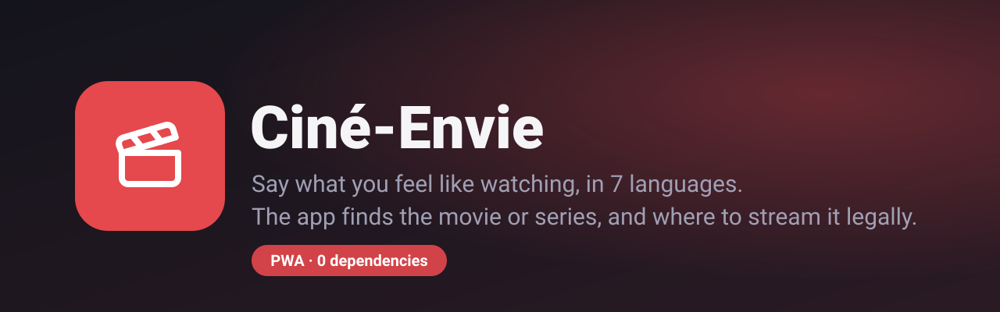
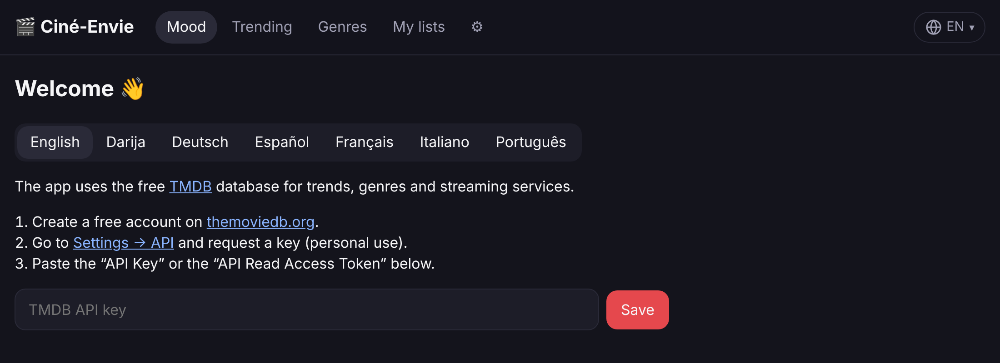
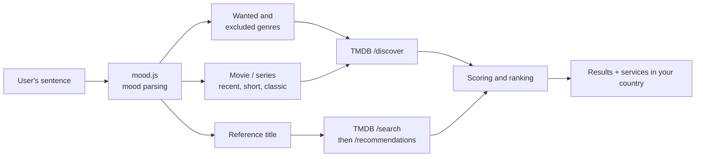

<p align="center"><b>English</b> · <a href="README.drj.md">Darija</a> · <a href="README.de.md">Deutsch</a> · <a href="README.es.md">Español</a> · <a href="README.fr.md">Français</a> · <a href="README.it.md">Italiano</a> · <a href="README.pt.md">Português</a></p>

<p align="center">
  
</p>

<p align="center">
  <a href="https://rliu-labs.github.io/cine-envie/"><b>▶ Try the app</b></a>
  ·
  <a href="#features">Features</a>
  ·
  <a href="#how-it-works">How it works</a>
  ·
  <a href="#security-and-privacy">Security</a>
  ·
  <a href="#run-locally">Run locally</a>
</p>

<p align="center">
  <a href="https://rliu-labs.github.io/cine-envie/"></a>
  <a href="https://github.com/rliu-labs/cine-envie/actions/workflows/tests.yml"></a>
  
  
  
  <a href="LICENSE"></a>
</p>

---

**Ciné‑Envie** answers the question everyone asks every evening: *"what shall we watch?"*.
You describe what you feel like watching the way you would tell a friend, **in English, French, Spanish, German, Italian, Portuguese or Moroccan Darija**, and the app suggests matching movies and series, along with **where to stream them legally in your country** (31 European countries).

> "A cozy, funny night with some mystery, like Knives Out"
> → moods *cozy, funny, mystery* · no horror or thriller · similar to *Knives Out*

It is an installable web app (PWA) with no server, no account and no dependencies: plain HTML, CSS and native JavaScript.

<p align="center">
  
</p>

## Features

| | |
|---|---|
| 💬 **Mood search** | Natural-language search that understands slang: moods, genres to avoid, movie or series, recent / short / classic, and a reference title ("like Dark", "comme Dark", "como Dark", "b7al Dark"). |
| 🌍 **7 languages** | Interface and search in **English**, **Darija** (Moroccan), **German**, **Spanish**, **French**, **Italian** and **Portuguese**; Darija is written in Latin script, with the digits 3, 7, 9… The app opens in English, and you can switch in one click from the header dropdown (globe) or in the settings. |
| 📺 **Movies and series** | Search, genres, trending, ratings and recommendations cover both movies and series. On the search page, one click picks **Movies**, **Series** or **Both**. |
| 🍿 **My streaming services** | In the settings, tick your subscriptions (Netflix, Prime Video and Disney+ by default; Canal+, Max… depending on your country). They become buttons on the search page: "All" searches across all your services, and clicking one narrows it down. Your services are also highlighted on every title page. |
| 📍 **Your country** | Pick your country of residence among 31 European countries, right from the title page: the services shown are the ones available where you live. |
| 🔥 **Trending** | This week's trending movies and series, with a **New** badge on what appeared since your last visit. |
| 🎭 **Genres** | Browse by genre, popularity or rating. |
| 🎬 **Title page** | Overview, director, cast, trailer and the legal streaming offers in the chosen country (subscription, free, rent, buy). |
| ⭐ **Taste profile** | Rate the titles you have seen from 1 to 5 stars: the app works out which genres you like or avoid, adjusts the ranking of every search and offers a "Recommended for you" selection. |
| 📋 **My lists** | "To watch" and "Seen", stored in the browser, with JSON export / import to move to another device. |
| 📱 **Installable** | On desktop (Chrome, Edge), Android and iPhone; the interface stays available offline. |
| 🖥️ **TV mode** | On a smart TV or a TV box (Android TV, Google TV, Fire TV, Samsung, LG…) the app switches by itself to a large display that reads from the sofa, driven with the remote: arrows to move, OK to open, Back to close. You can force it in the settings (Display: Auto, Phone / computer, TV) or with `?tv=1` in the address. |
| 🔎 **Title search, suggestions and voice** | Search by mood or by the exact title, with suggestions as you type (ready-made ideas or matching titles with their poster). Where the browser supports it (Chrome, Edge, Safari), a 🎤 button lets you say what you want. Every list ends with a **Show more** button. |
| 📲 **From phone to TV in one scan** | The TV shows a QR code; scan it with the phone where the app is already set up, confirm, and the TV gets your TMDB key, settings and lists. Nothing to type with the remote. |
| 🌗 **Light or dark theme** | Auto (follows the device), light or dark, in the settings. Cast photos on every title page. |

## Works on every screen

The same app adapts to the device it runs on, with nothing to configure:

| Device | Layout and controls | Tested browsers |
|---|---|---|
| 📱 **Phone** | One-column layout, large touch targets, can be installed on the home screen. | Safari (iPhone), Chrome (Android) |
| 💻 **Computer** | Wide grid of posters, mouse or keyboard (Tab, Enter, Escape). | Chrome, Edge, Firefox, Safari |
| 🖥️ **TV** | Large display that reads from the sofa, margins against screen cropping, remote control: arrows, OK, Back. Switches on by itself on smart TVs and TV boxes. | Samsung (Tizen), LG (webOS), Android TV / Google TV, Fire TV |

Tablets get the phone or computer layout depending on their width. To pick a mode yourself: **Settings → Display** (Auto, Phone / computer, TV), or add `?tv=1` (or `?tv=0`) to the address.

## Works on every screen

The same app adapts to the device it runs on, with nothing to configure:

| Device | Layout and controls | Tested browsers |
|---|---|---|
| 📱 **Phone** | One-column layout, large touch targets, can be installed on the home screen. | Safari (iPhone), Chrome (Android) |
| 💻 **Computer** | Wide grid of posters, mouse or keyboard (Tab, Enter, Escape). | Chrome, Edge, Firefox, Safari |
| 🖥️ **TV** | Large display that reads from the sofa, margins against screen cropping, remote control: arrows, OK, Back. Switches on by itself on smart TVs and TV boxes. | Samsung (Tizen), LG (webOS), Android TV / Google TV, Fire TV |

Tablets get the phone or computer layout depending on their width. To pick a mode yourself: **Settings → Display** (Auto, Phone / computer, TV), or add `?tv=1` (or `?tv=0`) to the address.

## How it works

The heart of the app is [`js/mood.js`](js/mood.js): a small natural-language parser (English, French, Spanish, German, Italian, Portuguese, Darija), with no external service, that turns a sentence into search criteria.



Real parser output:

| What you type | Moods | Type | Excluded | Reference |
|---|---|---|---|---|
| A cozy, funny night with some mystery, like Knives Out | cozy, funny, mystery | all | Horror, Thriller, War | Knives Out |
| a classic 90s thriller | tension | all · classic | | |
| I would like something funny | funny | all | | *(none: "like" is not taken as a title)* |
| a dad movie with explosions | dad movie, action | movie | | |
| soirée cosy, drôle avec de l'intrigue comme À couteaux tirés | cozy, funny, mystery | all | Horror, Thriller, War | À couteaux tirés |
| une série à binger qui me retourne le cerveau | mystery | series | | |
| una serie de suspense como Dark | mystery, tension | series | | Dark |
| una peli para partirse de risa | funny | movie | | |
| bghit chi film dyal d7k | funny | movie | | |
| msalsal jdid b7al Dark w fih d7k | funny | series · recent | | Dark |
| soirée cosy, film dyal d7k w l7ob | cozy, funny, romance | movie | Horror, Thriller, War | |
| ein neuer Actionfilm, der sich nicht zu ernst nimmt | action | movie · recent | | |
| una serata rilassante, divertente e con un po' di mistero, come Cena con delitto | cozy, funny, mystery | all | Horror, Thriller, War | Cena con delitto |
| um filme curto para rir com os miúdos | funny, family | movie · short | Horror | |

Each result then gets a score: +3 per wanted genre, −6 per excluded genre, plus its rating and popularity, and a bonus if it comes from the reference title's recommendations.

In **Spanish**, the parser also understands everyday slang from Spain ("peli", "partirse de risa", "da yuyu", "de tiros"…), and TMDB title pages are shown in Spanish. German, Italian and Portuguese work the same way, with everyday words in each ("gruselig", "zum Heulen", "giallo", "da sbellicarsi", "miúdos", "porrada"…) and German compound words such as "Actionfilm".

**Darija** has no fixed spelling in Latin script: the parser first folds the letter-digits (3 → ع, 7 → ح, 9 → ق…) and doubled letters, then recognises words with flexible patterns that accept spelling variants ("d7k", "dahk", "kaydahek") and verb prefixes. The Darija interface follows the "Arabizi" spelling commonly used in Morocco; it would benefit from a review by a native speaker, and suggestions are welcome. TMDB title pages are then shown in French.

The **taste profile** adds to this score: each rating gives its genres an affinity between −1 (1★) and +1 (5★), averaged and smoothed so that a single movie does not dominate. Everything is computed in the browser.

## Architecture

```
├── index.html             App shell
├── style.css              Dark theme, responsive layout
├── js/
│   ├── app.js             Views, hash navigation, title page
│   ├── mood.js            Mood parsing and scoring (pure JS, tested)
│   ├── i18n.js            Strings in 7 languages, European countries, language and country detection
│   ├── tmdb.js            TMDB API client (configurable language and country, in-memory cache)
│   └── store.js           Local storage: language, country, key, lists, ratings, last visit
├── sw.js                  Service worker (offline interface, poster cache)
├── manifest.webmanifest   PWA manifest
├── icons/                 App icon, TMDB logo
├── scripts/captures.mjs   Generates the README screenshots and GIF (Playwright)
└── tests/                 node:test tests (parser, profile, translations, TMDB client)
```

**Technical choices**
- **No build, no dependencies**: native ES modules, served as-is by GitHub Pages.
- **v3 key or v4 token**: the client detects the format and uses either the `api_key` parameter or the `Bearer` header.
- **Network-first service worker**: updates arrive immediately, and the cache takes over offline.

## Security and privacy

Ciné‑Envie is designed to know nothing about you.

| | |
|---|---|
| 🖥️ **No server** | A 100% static site hosted on GitHub Pages, served over HTTPS. |
| 🔑 **Your key stays with you** | The TMDB key is stored in your browser and sent only to the TMDB API. |
| 🙈 **No tracking** | No analytics, ads or cookies. |
| 🌐 **What your browser contacts** | TMDB (data and images) and GitHub Pages, which hosts the app and may log your IP address. Trailers open on YouTube. |
| 📲 **QR code transfer** | Only when you use it: the data is encrypted in your browser (AES-GCM) and passes through the public ntfy.sh relay, which cannot read it (the key stays in the QR code) and deletes it within 12 hours. Voice search sends the audio to the browser's speech service (Google for Chrome, Apple for Safari). |
| 📦 **Zero dependencies** | The page loads no npm package or external script: nothing that can be compromised upstream. (The only npm packages are used to generate screenshots, never by the app.) |
| 🛡️ **Content Security Policy** | The browser blocks any foreign script and any connection outside TMDB and the ntfy.sh relay. |
| 🧹 **Escaped data** | Everything that comes from TMDB or from an import is neutralised before it is displayed. |

Found a vulnerability? See [SECURITY.md](SECURITY.md) to report it privately.

## Run locally

```bash
git clone https://github.com/rliu-labs/cine-envie.git
cd cine-envie
python3 -m http.server 8000   # or: npm start
```

Open http://localhost:8000 and paste your TMDB key (free: themoviedb.org → Settings → API).

Tests:

```bash
npm test
```

Demo screenshots and GIF, with real data (requires your TMDB key):

```bash
npm install
npx playwright install chromium
TMDB_KEY=your_key npm run captures   # output in docs/captures/
```

Ideas are welcome: see [CONTRIBUTING.md](CONTRIBUTING.md).

## Credits

<a href="https://www.themoviedb.org/"></a>

Movie and series data and images: [TMDB](https://www.themoviedb.org/).
*This product uses the TMDB API but is not endorsed or certified by TMDB.*

Streaming availability: [JustWatch](https://www.justwatch.com/), via the TMDB API.

Icon: "clapperboard" pictogram from [Lucide](https://lucide.dev) (ISC licence, see [icons/LICENSE-lucide.txt](icons/LICENSE-lucide.txt)).

Netflix, Prime Video, Disney+ and other service names and logos are trademarks of their respective owners. Ciné‑Envie is not affiliated with any of these services, nor with TMDB or JustWatch.

Free, non-commercial personal project published by rliu-labs, hosted by GitHub, Inc. (88 Colin P. Kelly Jr. Street, San Francisco, CA 94107, USA). Contact: [GitHub issues](https://github.com/rliu-labs/cine-envie/issues).

Code under the [MIT](LICENSE) licence.
