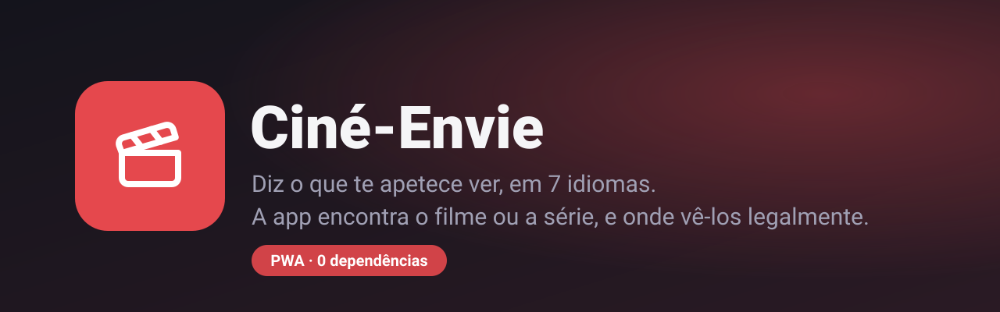
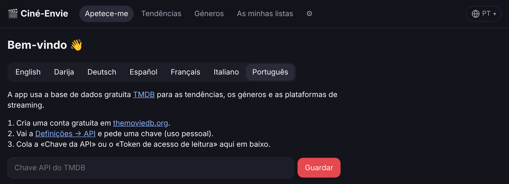
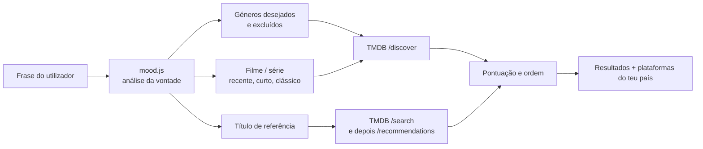

<p align="center"><a href="README.md">English</a> · <a href="README.drj.md">Darija</a> · <a href="README.de.md">Deutsch</a> · <a href="README.es.md">Español</a> · <a href="README.fr.md">Français</a> · <a href="README.it.md">Italiano</a> · <b>Português</b></p>

<p align="center">
  
</p>

<p align="center">
  <a href="https://rliu-labs.github.io/cine-envie/"><b>▶ Experimentar a app</b></a>
  ·
  <a href="#funcionalidades">Funcionalidades</a>
  ·
  <a href="#como-funciona">Como funciona</a>
  ·
  <a href="#segurança-e-privacidade">Segurança</a>
  ·
  <a href="#executar-localmente">Executar localmente</a>
</p>

<p align="center">
  <a href="https://rliu-labs.github.io/cine-envie/"></a>
  <a href="https://github.com/rliu-labs/cine-envie/actions/workflows/tests.yml"></a>
  
  
  
  <a href="LICENSE"></a>
</p>

---

**Ciné‑Envie** responde à pergunta de todas as noites: *«o que é que vamos ver?»*.
Escreves o que te apetece ver como dirias a um amigo, **em português, inglês, francês, espanhol, alemão, italiano ou darija marroquino**, e a app propõe filmes e séries à medida, com **onde os ver legalmente no teu país** (cerca de 140 países).

> «Uma noite tranquila, divertida e com mistério, como Knives Out»
> → ambiente *tranquilo, divertido, mistério* · sem terror nem thriller · parecido com *Knives Out*

É uma aplicação web instalável (PWA), sem servidor, sem conta e sem dependências: HTML, CSS e JavaScript nativo.

<p align="center">
  
</p>

## Funcionalidades

| | |
|---|---|
| 💬 **Apetece-me** | Pesquisa em linguagem natural, que percebe a linguagem do dia a dia: ambiente, géneros a evitar, filme ou série, recente / curto / clássico e um título de referência («como Dark», «like Dark», «comme Dark», «wie Dark»). |
| 🌍 **7 idiomas** | Interface e pesquisa em **inglês**, **darija** (marroquino, em alfabeto latino com os algarismos 3, 7, 9…), **alemão**, **espanhol**, **francês**, **italiano** e **português**. A app abre em inglês e o idioma muda-se com um clique no menu do topo (globo) ou nas definições. |
| 📺 **Filmes e séries** | A pesquisa, os géneros, as tendências, as notas e as recomendações abrangem filmes e séries. Na página de pesquisa, um clique escolhe **Filmes**, **Séries** ou **Ambos**. |
| 🍿 **As minhas plataformas** | Nas definições, marca as tuas subscrições (por defeito Netflix, Prime Video e Disney+; HBO Max, SkyShowtime… conforme o país). Tornam-se botões na página de pesquisa: «Todas» pesquisa em todas as tuas plataformas e um clique numa delas afina a pesquisa. As tuas plataformas também aparecem em destaque em cada ficha. |
| 📍 **O teu país** | Escolhe o país de residência entre cerca de 140 países (Europa, Américas, África, Médio Oriente, Ásia, Oceânia), diretamente na ficha: as plataformas mostradas são as disponíveis onde vives. |
| 🔥 **Tendências** | Filmes e séries em tendência esta semana, com um selo **Novo** no que apareceu desde a tua última visita. |
| 🎭 **Géneros** | Explora por género, popularidade ou nota. |
| 🎬 **Ficha** | Sinopse, realização, elenco com fotos, trailer dentro da ficha e as ofertas legais do país escolhido (subscrição, grátis, aluguer, compra). Toca num ator para ver os outros filmes e séries. |
| ⭐ **Perfil de gostos** | Dá de 1 a 5 estrelas ao que viste: a app percebe de que géneros gostas ou foges, ajusta a ordem de cada pesquisa e sugere uma seleção «Recomendado para ti». |
| 📋 **As minhas listas** | «Para ver» e «Vistos», guardados no navegador, com exportação / importação JSON para mudar de dispositivo. |
| 📱 **Instalável** | No computador (Chrome, Edge), Android e iPhone; a interface continua disponível offline. |
| 🖥️ **Modo TV** | Numa smart TV ou numa box (Android TV, Google TV, Fire TV, Samsung, LG…), a app passa sozinha para uma vista grande que se lê do sofá e usa-se com o comando: setas para mover, OK para abrir, Voltar para fechar. Pode ser forçado nas definições (Ecrã: Auto, Telemóvel / computador, TV) ou com `?tv=1` no endereço. |
| 🔎 **Pesquisa por título e por voz** | Pesquisa por vontade ou por título, com sugestões enquanto escreves, um botão 🎤 para ditar e **Ver mais** sob cada lista. |
| 📲 **Do telemóvel para a TV num scan** | Lê com o telemóvel o código QR mostrado na TV: recebe a chave, as definições e as listas. |
| 🌗 **Tema claro ou escuro** | Auto, claro ou escuro. |
| 🔔 **Avisos Para ver** | Um aviso diz-te quando um título da lista «Para ver» chega a uma das tuas plataformas ou tem nova temporada. |

## Compatível com todos os ecrãs

A mesma app adapta-se ao aparelho, sem configurar nada:

| Aparelho | Vista e comandos | Navegadores testados |
|---|---|---|
| 📱 **Telemóvel** | Uma coluna, zonas de toque grandes, instalável no ecrã principal. | Safari (iPhone), Chrome (Android) |
| 💻 **Computador** | Grelha larga de cartazes, rato ou teclado (Tab, Enter, Esc). | Chrome, Edge, Firefox, Safari |
| 🖥️ **TV** | Vista grande que se lê do sofá, margens contra o corte do ecrã, comando: setas, OK, Voltar. Ativa-se sozinha em smart TVs e boxes de TV. | Samsung (Tizen), LG (webOS), Android TV / Google TV, Fire TV |

Os tablets usam a vista de telemóvel ou de computador conforme a largura. Para escolher: **Definições → Ecrã** (Auto, Telemóvel / computador, TV), ou `?tv=1` (ou `?tv=0`) no endereço.

## Como funciona

O coração da app é [`js/mood.js`](js/mood.js): um pequeno analisador de linguagem natural (inglês, português, francês, espanhol, alemão, italiano, darija), sem serviços externos, que transforma uma frase em critérios de pesquisa.



Resultados reais do analisador:

| O que escreves | Ambiente | Tipo | Excluído | Referência |
|---|---|---|---|---|
| uma noite tranquila, divertida e com mistério, como Knives Out | tranquilo, divertido, mistério | tudo | Terror, Thriller, Guerra | Knives Out |
| um filme de ação recente | ação | filme · recente | | |
| uma série de suspense como Dark | mistério, tensão | série | | Dark |
| um filme curto para rir com os miúdos | divertido, família | filme · curto | Terror | |
| A cozy, funny night with some mystery, like Knives Out | tranquilo, divertido, mistério | tudo | Terror, Thriller, Guerra | Knives Out |
| una serie de suspense como Dark | mistério, tensão | série | | Dark |
| bghit chi film dyal d7k | divertido | filme | | |

Cada resultado recebe depois uma pontuação: +3 por cada género desejado, −6 por cada género excluído, mais a nota e a popularidade, e um bónus se vier das recomendações do título de referência.

Em **português**, o analisador percebe também a linguagem do dia a dia («miúdos», «porrada», «lamechas», «meta medo»…), e as fichas do TMDB aparecem em português. Alemão, italiano e espanhol funcionam da mesma forma.

O **darija** não tem uma ortografia fixa em alfabeto latino: o analisador começa por uniformizar os algarismos-letra (3 → ع, 7 → ح, 9 → ق…) e as letras duplas, e depois reconhece as palavras com padrões flexíveis que aceitam variantes («d7k», «dahk», «kaydahek») e prefixos verbais. A interface em darija segue a escrita «arabizi» comum em Marrocos; merecia uma revisão por um falante nativo, e as sugestões são bem-vindas. As fichas do TMDB aparecem então em francês.

O **perfil de gostos** soma-se a esta pontuação: cada nota dá aos seus géneros uma afinidade entre −1 (1★) e +1 (5★), em média e suavizada para que um só filme não decida tudo. Tudo é calculado no navegador.

## Arquitetura

```
├── index.html             Estrutura da app
├── style.css              Tema claro e escuro, layout adaptável
├── js/
│   ├── app.js             Vistas, navegação por hash, ficha detalhada
│   ├── mood.js            Análise da vontade e pontuação (JS puro, testado)
│   ├── i18n.js            Textos em 7 idiomas, cerca de 140 países, deteção do país
│   ├── tmdb.js            Cliente da API do TMDB (idioma e país configuráveis, cache em memória)
│   ├── store.js           Armazenamento local: idioma, país, chave, listas, notas, última visita
│   ├── tv.js              Modo TV: navegação com o comando
│   ├── qr.js              Gerador de códigos QR (sem dependências)
│   ├── pair.js            Transferência cifrada do telemóvel para a TV
│   └── alerts.js          Avisos «Para ver» (nova plataforma, nova temporada)
├── sw.js                  Service worker (interface offline, cache dos cartazes)
├── manifest.webmanifest   Manifesto PWA
├── icons/                 Ícone da app, logótipo do TMDB
├── scripts/captures.mjs   Gera as capturas de ecrã e o GIF do README (Playwright)
└── tests/                 Testes node:test (analisador, perfil, traduções, cliente TMDB, TV, QR, transferência, avisos)
```

**Escolhas técnicas**
- **Sem build nem dependências**: módulos ES nativos, servidos tal como estão pelo GitHub Pages.
- **Chave v3 ou token v4**: o cliente deteta o formato e usa o parâmetro `api_key` ou o cabeçalho `Bearer`.
- **Service worker «rede primeiro»**: as atualizações chegam logo e a cache assume o controlo offline.

## Segurança e privacidade

O Ciné‑Envie foi pensado para não saber nada sobre ti.

| | |
|---|---|
| 🖥️ **Sem servidor** | Site 100 % estático alojado no GitHub Pages, servido em HTTPS. |
| 🔑 **A tua chave fica contigo** | A chave do TMDB fica guardada no teu navegador e só é enviada para a API do TMDB. |
| 🙈 **Sem rastreio** | Sem estatísticas, publicidade nem cookies. |
| 🌐 **O que o teu navegador contacta** | O TMDB (dados e imagens) e o GitHub Pages, que aloja a app e pode registar o teu endereço IP. Os trailers abrem no YouTube. |
| 📲 **Transferência e voz** | A transferência telemóvel → TV é cifrada e passa por um relé público que não a consegue ler; o ditado usa o serviço de voz do navegador. Detalhes na nota de privacidade da app (rodapé). |
| 📦 **Zero dependências** | A página não carrega nenhum pacote npm nem script externo: nada que possa ser comprometido a montante. (Os únicos pacotes npm servem para gerar as capturas, nunca para a app.) |
| 🛡️ **Content Security Policy** | O navegador bloqueia qualquer script estranho e qualquer ligação fora do TMDB e do relé ntfy.sh. |
| 🧹 **Dados neutralizados** | Tudo o que vem do TMDB ou de uma importação é neutralizado antes de ser mostrado. |

Encontraste uma falha de segurança? Consulta [SECURITY.md](SECURITY.md) para a comunicar em privado.

## Executar localmente

```bash
git clone https://github.com/rliu-labs/cine-envie.git
cd cine-envie
python3 -m http.server 8000   # ou: npm start
```

Abre http://localhost:8000 e cola a tua chave do TMDB (gratuita: themoviedb.org → Definições → API).

Testes:

```bash
npm test
```

Capturas de ecrã e GIF de demonstração com dados reais (precisa da tua chave do TMDB):

```bash
npm install
npx playwright install chromium
TMDB_KEY=a_tua_chave npm run captures   # resultado em docs/captures/
```

As ideias são bem-vindas: vê [CONTRIBUTING.md](CONTRIBUTING.md).

## Créditos

<a href="https://www.themoviedb.org/"></a>

Dados e imagens de filmes e séries: [TMDB](https://www.themoviedb.org/).
*This product uses the TMDB API but is not endorsed or certified by TMDB.*

Disponibilidade em streaming: [JustWatch](https://www.justwatch.com/), através da API do TMDB.

Ícone: pictograma «clapperboard» do [Lucide](https://lucide.dev) (licença ISC, ver [icons/LICENSE-lucide.txt](icons/LICENSE-lucide.txt)).

Netflix, Prime Video, Disney+ e os outros nomes e logótipos de plataformas são marcas dos respetivos proprietários. A Ciné‑Envie não está afiliada a nenhum destes serviços, nem ao TMDB ou à JustWatch.

Informação legal: projeto pessoal, gratuito e não comercial, publicado por rliu-labs e alojado pela GitHub, Inc. (88 Colin P. Kelly Jr. Street, San Francisco, CA 94107, EUA). Contacto: [issues do GitHub](https://github.com/rliu-labs/cine-envie/issues).

Código sob licença [MIT](LICENSE).
